# Your first Thunder plugin: a guided journey

Last updated: 2026-11-11

Welcome to the OORO TV team. This guide takes you from "what is Thunder?" to a
working plugin of your own, running on the TV and answering calls from the UI.
Along the way you'll see how the pieces of the system fit together.

You will build **HelloWorld**, a small but complete plugin that:

- answers a method call: `sayHello {"name":"Mahmoud"}` → `"Hello, Mahmoud!"`
- keeps state you can read and change: `getGreeting`, `setGreeting`
- sends an event to listeners: `onGreeted`
- reads its default greeting from its configuration file

> **Status of the code in this guide.** Every file below was built with
> `bitbake lib32-helloworld-plugin` against Thunder R4.2 in
> `/home/rdkuser/OROO-6.5.0` on 2026-11-11: it compiled with no warnings, and the
> generated `HelloWorld.json` is shown in Stop 11. It has not yet been run on a
> TV, so Stops 12–14 describe the expected results.

> Diagrams use Mermaid. GitHub renders them directly. In VS Code, install the
> *Markdown Preview Mermaid Support* extension to see them in the preview.

---

## The route


**Before you start, you need:**

- A shell on the build machine with the 6.5.0 tree at `/home/rdkuser/OROO-6.5.0`
- A TV running the 6.5.0 debug image, with a serial console or SSH, on the same
  network as your PC
- Basic C++ (classes, virtual functions) and a little JSON

---

## Stop 1: where Thunder lives

Thunder (its process is called `WPEFramework`) is the centre of the TV
software. The UI never talks to drivers or daemons directly: it asks a Thunder
plugin, and the plugin does the work.

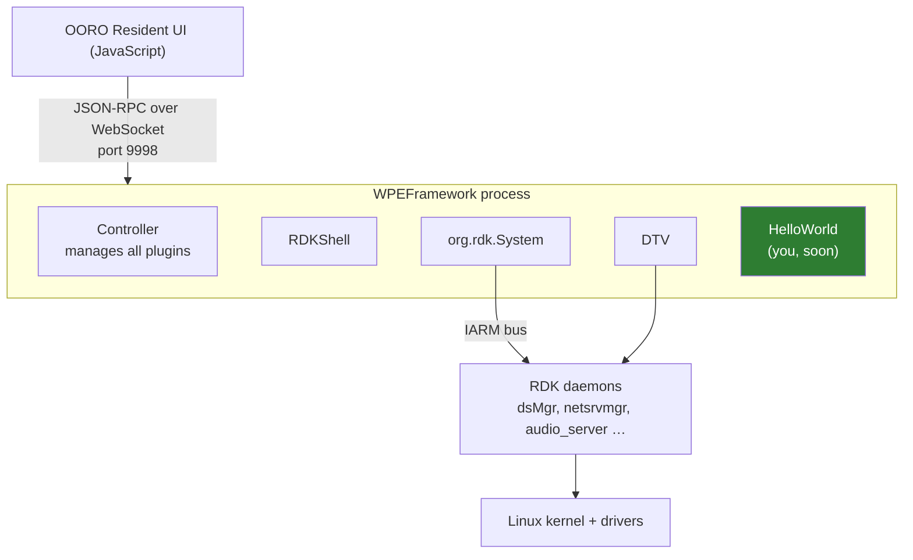

Your HelloWorld plugin sits next to the real ones such as `org.rdk.System` and
`DTV`. It uses the same loading, configuration and call mechanism they do. The
only difference is that it doesn't talk to any hardware.

For the full system picture, see [`RDK-6.5.0-ARCHITECTURE.md`](RDK-6.5.0-ARCHITECTURE.md).

---

## Stop 2: Thunder in five ideas

### Idea 1: a plugin is a shared library

Each plugin is a `.so` file in `/usr/lib/wpeframework/plugins/`, with a
matching config file in `/etc/WPEFramework/plugins/`. When `WPEFramework` starts,
it reads every config file and knows what plugins exist.

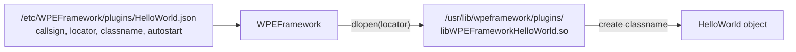

### Idea 2: the callsign is the plugin's name on the bus

The **callsign** is the name clients use, such as `HelloWorld`,
`org.rdk.System` or `DTV`. A method is called as `<callsign>.<version>.<method>`:

```text
HelloWorld.1.sayHello
└──┬─────┘ │ └──┬───┘
callsign   │  method
        API version
```

### Idea 3: every plugin has a lifecycle

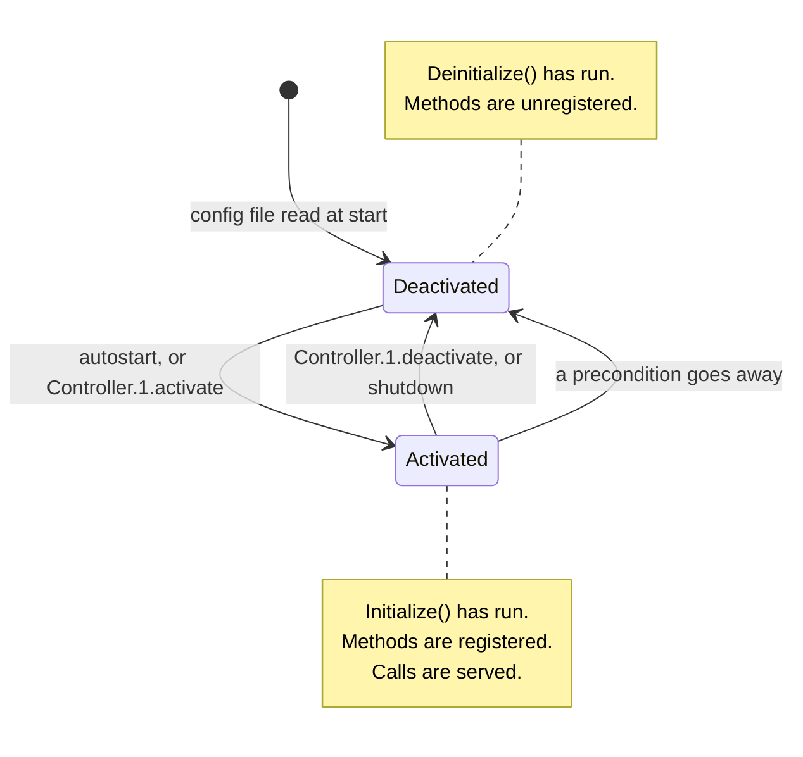

You write two functions for this:

| Function | Called when | You do |
|---|---|---|
| `Initialize(IShell*)` | The plugin is activated | Read config, register methods, start work. Return `""` for success, or an error text |
| `Deinitialize(IShell*)` | The plugin is deactivated | Undo everything `Initialize` did |

### Idea 4: clients talk JSON-RPC 2.0

A call is a small JSON message. The plugin answers with `result` or `error`.

```text
request :  {"jsonrpc":"2.0","id":1,"method":"HelloWorld.1.sayHello","params":{"name":"Mahmoud"}}
response:  {"jsonrpc":"2.0","id":1,"result":{"message":"Hello, Mahmoud!","count":1,"success":true}}
```

### Idea 5: plugins run in-process or out-of-process

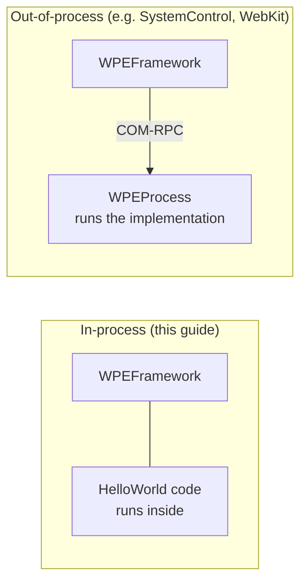

In-process is simplest and fastest, but a crash in your plugin crashes
`WPEFramework` for everyone. That's why big or risky plugins run out-of-process.
Start in-process; [Stop 17](#stop-17-where-to-go-next) shows the next step.

---

## Stop 3: anatomy of a call

This is what happens, step by step, when the UI calls your plugin and you send
an event back.

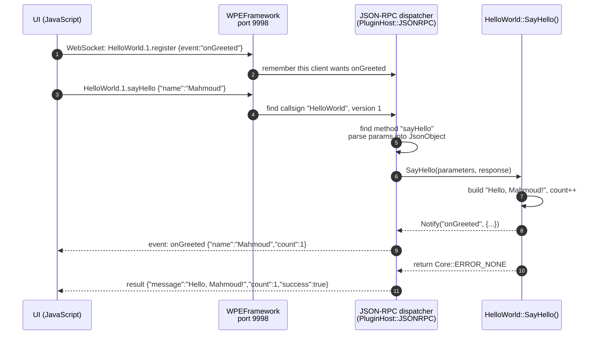

Two important points:

- **You never parse JSON text yourself.** Thunder turns `params` into a
  `JsonObject` for you, and turns your `response` object back into JSON.
- **The return code matters.** `Core::ERROR_NONE` gives the client `result`.
  Any other code, such as `Core::ERROR_BAD_REQUEST`, gives the client an
  `error` object instead.

---

## Stop 4: talk to a real TV first

Before writing code, see Thunder answer on a real TV. Run these on the TV
console. On a PC, replace `127.0.0.1` with the TV's IP address.

> On this debug image, Thunder security is off
> (`ThunderSecurity.Enable = false`), so no token is needed. Production
> images may require a token from the `SecurityAgent` plugin.

**Ask the Controller for one plugin's state:**

```sh
curl -s -X POST -H 'Content-Type: application/json' \
  -d '{"jsonrpc":"2.0","id":1,"method":"Controller.1.status@org.rdk.System"}' \
  http://127.0.0.1:9998/jsonrpc
```

The answer lists the plugin's callsign, its state (`activated`), its config and
more.

**Call a real plugin method:**

```sh
curl -s -X POST -H 'Content-Type: application/json' \
  -d '{"jsonrpc":"2.0","id":2,"method":"org.rdk.System.1.getDevicePowerState"}' \
  http://127.0.0.1:9998/jsonrpc
```

Expected: `{"jsonrpc":"2.0","id":2,"result":{"powerState":"ON","success":true}}`.
That is exactly the shape your plugin will produce.

---

## Stop 5: the project layout

The plugin is one small recipe in `meta-elaraby-aml`:

```text
meta-elaraby-aml/recipes-extended/helloworld-plugin/
├── helloworld-plugin_1.0.bb          ← Stop 10: how Yocto builds it
└── files/
    └── helloworld/                   ← the plugin source
        ├── CMakeLists.txt            ← Stop 9: how CMake builds it
        ├── HelloWorld.conf.in        ← Stop 8: its config file template
        ├── Module.h                  ← Stop 6: module boilerplate
        ├── Module.cpp                ← Stop 6
        ├── HelloWorld.h              ← Stop 7: the class
        └── HelloWorld.cpp            ← Stop 7: the code
```

How the files turn into what runs on the TV:

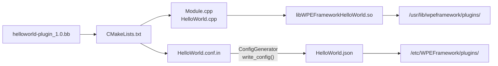

Create the folders:

```sh
cd /home/rdkuser/OROO-6.5.0/meta-elaraby-aml
mkdir -p recipes-extended/helloworld-plugin/files/helloworld
```

---

## Stop 6: module boilerplate (`Module.h`, `Module.cpp`)

Every Thunder plugin has these two small files. They give the library a name
and pull in the Thunder plugin API.

**`files/helloworld/Module.h`**

```cpp
#pragma once

#ifndef MODULE_NAME
#define MODULE_NAME Plugin_HelloWorld
#endif

#include <plugins/plugins.h>

#undef EXTERNAL
#define EXTERNAL
```

| Line | Why |
|---|---|
| `MODULE_NAME Plugin_HelloWorld` | Names this module in Thunder's logging and tracing |
| `#include <plugins/plugins.h>` | The whole plugin API: `IPlugin`, `IShell`, `JSONRPC`, JSON types, logging |
| `EXTERNAL` redefined empty | Plugins don't export extra symbols, so this macro is not needed here |

**`files/helloworld/Module.cpp`**

```cpp
#include "Module.h"

MODULE_NAME_DECLARATION(BUILD_REFERENCE)
```

`MODULE_NAME_DECLARATION` adds the module name and build reference into the
library, so Thunder can identify it at load time. Every plugin has exactly one.

---

## Stop 7: the plugin class (`HelloWorld.h`, `HelloWorld.cpp`)

### 7.1 The shape of the class

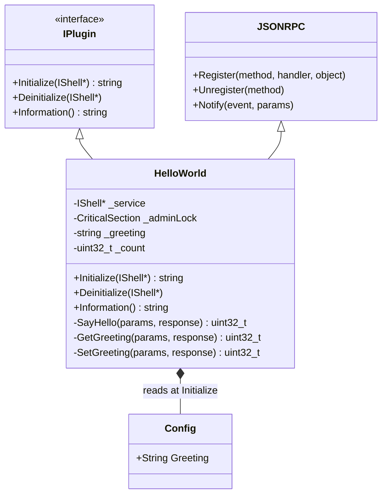

- **`IPlugin`** is the lifecycle contract from Stop 2.
- **`JSONRPC`** gives you method registration and events for free.
- **`Config`** describes the `configuration` part of `HelloWorld.json`.

### 7.2 `files/helloworld/HelloWorld.h`

```cpp
#pragma once

#include "Module.h"

namespace WPEFramework {
namespace Plugin {

    class HelloWorld : public PluginHost::IPlugin, public PluginHost::JSONRPC {
    private:
        // Reads the "configuration" object of HelloWorld.json.
        class Config : public Core::JSON::Container {
        public:
            Config(const Config&) = delete;
            Config& operator=(const Config&) = delete;

            Config()
                : Core::JSON::Container()
                , Greeting(_T("Hello"))
            {
                Add(_T("greeting"), &Greeting);
            }
            ~Config() override = default;

        public:
            Core::JSON::String Greeting;
        };

    public:
        HelloWorld(const HelloWorld&) = delete;
        HelloWorld& operator=(const HelloWorld&) = delete;

        HelloWorld();
        ~HelloWorld() override;

        BEGIN_INTERFACE_MAP(HelloWorld)
            INTERFACE_ENTRY(PluginHost::IPlugin)
            INTERFACE_ENTRY(PluginHost::IDispatcher)
        END_INTERFACE_MAP

        // PluginHost::IPlugin
        const string Initialize(PluginHost::IShell* service) override;
        void Deinitialize(PluginHost::IShell* service) override;
        string Information() const override;

    private:
        // JSON-RPC methods
        uint32_t SayHello(const JsonObject& parameters, JsonObject& response);
        uint32_t GetGreeting(const JsonObject& parameters, JsonObject& response);
        uint32_t SetGreeting(const JsonObject& parameters, JsonObject& response);

    private:
        PluginHost::IShell* _service;
        mutable Core::CriticalSection _adminLock;
        string _greeting;
        uint32_t _count;
    };

} // namespace Plugin
} // namespace WPEFramework
```

What each part does:

| Part | Explanation |
|---|---|
| `namespace WPEFramework::Plugin` | All plugins live here, so Thunder types resolve without prefixes |
| `class Config : Core::JSON::Container` | A typed view of JSON. `Add("greeting", &Greeting)` maps the JSON key to a member. `"Hello"` is the default if the key is missing |
| Deleted copy constructor and assignment | Thunder owns the object; copying it would be a bug |
| `BEGIN_INTERFACE_MAP … END_INTERFACE_MAP` | Tells Thunder which interfaces this object offers. `IPlugin` for the lifecycle, `IDispatcher` for JSON-RPC (it comes from `JSONRPC`). Without this map, Thunder cannot find either |
| `uint32_t Method(const JsonObject&, JsonObject&)` | The signature every JSON-RPC method here uses: request params in, response out, error code returned |
| `_service` | The `IShell` handle Thunder gives you: your config, your callsign, and access to other plugins |
| `_adminLock` | Calls can arrive on several Thunder worker threads at once, so shared state needs a lock |

### 7.3 `files/helloworld/HelloWorld.cpp`

```cpp
#include "HelloWorld.h"

namespace WPEFramework {

namespace {
    // Tells Thunder the plugin version and which subsystems it needs.
    static Plugin::Metadata<Plugin::HelloWorld> metadata(
        // Version (Major, Minor, Patch)
        1, 0, 0,
        // Preconditions: subsystems that must be up before activation
        {},
        // Terminations: subsystems that deactivate the plugin when they go down
        {},
        // Controls: subsystems this plugin reports as up
        {}
    );
}

namespace Plugin {

    // Makes the class loadable by name ("HelloWorld" in HelloWorld.json).
    SERVICE_REGISTRATION(HelloWorld, 1, 0, 0);

    HelloWorld::HelloWorld()
        : PluginHost::JSONRPC()
        , _service(nullptr)
        , _adminLock()
        , _greeting()
        , _count(0)
    {
    }

    HelloWorld::~HelloWorld() = default;

    const string HelloWorld::Initialize(PluginHost::IShell* service)
    {
        ASSERT(service != nullptr);
        ASSERT(_service == nullptr);

        _service = service;
        _service->AddRef();

        Config config;
        config.FromString(_service->ConfigLine());
        _greeting = config.Greeting.Value();

        Register<JsonObject, JsonObject>(_T("sayHello"), &HelloWorld::SayHello, this);
        Register<JsonObject, JsonObject>(_T("getGreeting"), &HelloWorld::GetGreeting, this);
        Register<JsonObject, JsonObject>(_T("setGreeting"), &HelloWorld::SetGreeting, this);

        SYSLOG(Logging::Startup, (_T("HelloWorld: initialized with greeting '%s'"), _greeting.c_str()));

        // An empty string means success. Any text is an error and Thunder
        // will not activate the plugin.
        return string();
    }

    void HelloWorld::Deinitialize(PluginHost::IShell* service)
    {
        ASSERT(_service == service);

        Unregister(_T("sayHello"));
        Unregister(_T("getGreeting"));
        Unregister(_T("setGreeting"));

        _service->Release();
        _service = nullptr;

        SYSLOG(Logging::Shutdown, (_T("HelloWorld: deinitialized")));
    }

    string HelloWorld::Information() const
    {
        // Not used for JSON-RPC; may return an empty string.
        return string();
    }

    // HelloWorld.1.sayHello {"name":"Mahmoud"}  ->  {"message":"Hello, Mahmoud!","count":1}
    uint32_t HelloWorld::SayHello(const JsonObject& parameters, JsonObject& response)
    {
        if (parameters.HasLabel(_T("name")) == false) {
            response[_T("success")] = false;
            return Core::ERROR_BAD_REQUEST;
        }

        const string name = parameters[_T("name")].String();

        _adminLock.Lock();
        const string message = _greeting + _T(", ") + name + _T("!");
        const uint32_t count = ++_count;
        _adminLock.Unlock();

        response[_T("message")] = message;
        response[_T("count")] = count;
        response[_T("success")] = true;

        // Event to every client that registered for "onGreeted".
        JsonObject event;
        event[_T("name")] = name;
        event[_T("count")] = count;
        Notify(_T("onGreeted"), event);

        return Core::ERROR_NONE;
    }

    // HelloWorld.1.getGreeting  ->  {"greeting":"Hello"}
    uint32_t HelloWorld::GetGreeting(const JsonObject& parameters VARIABLE_IS_NOT_USED, JsonObject& response)
    {
        _adminLock.Lock();
        response[_T("greeting")] = _greeting;
        _adminLock.Unlock();
        response[_T("success")] = true;
        return Core::ERROR_NONE;
    }

    // HelloWorld.1.setGreeting {"greeting":"Ahlan"}  ->  {"success":true}
    uint32_t HelloWorld::SetGreeting(const JsonObject& parameters, JsonObject& response)
    {
        if ((parameters.HasLabel(_T("greeting")) == false) || parameters[_T("greeting")].String().empty()) {
            response[_T("success")] = false;
            return Core::ERROR_BAD_REQUEST;
        }

        _adminLock.Lock();
        _greeting = parameters[_T("greeting")].String();
        _adminLock.Unlock();

        response[_T("success")] = true;
        return Core::ERROR_NONE;
    }

} // namespace Plugin
} // namespace WPEFramework
```

### 7.4 Walking through the code

**Registration: how Thunder finds your class**

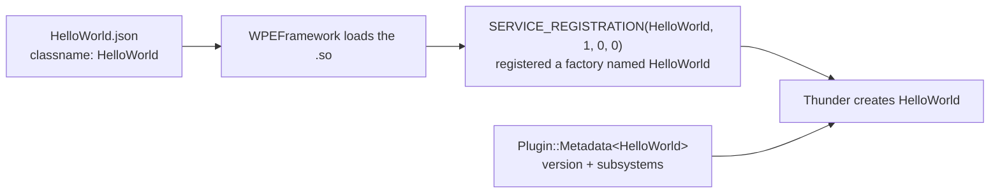

- `SERVICE_REGISTRATION(HelloWorld, 1, 0, 0)` registers a factory under the class
  name, so the `classname` in the config file can be turned into an object.
- `Plugin::Metadata<HelloWorld>` is new in Thunder R4. It carries the version
  and three lists of **subsystems** (for example `PLATFORM`, `NETWORK`,
  `GRAPHICS`):
  - *Preconditions*: don't activate until these are up
  - *Terminations*: deactivate if these go down
  - *Controls*: subsystems this plugin itself signals

  HelloWorld needs none, so all three lists are empty. A plugin that needs the
  network would list it under preconditions.

**`Initialize`: what happens on activation**

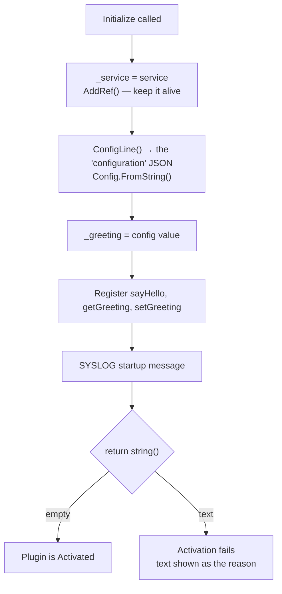

- **`AddRef()` / `Release()`:** Thunder uses reference counting. Keep a reference
  while you hold the pointer, and release it in `Deinitialize`.
- **`ConfigLine()`:** returns the `configuration` object from `HelloWorld.json`
  as text. `Config::FromString()` fills the typed members.
- **`Register<JsonObject, JsonObject>("sayHello", &HelloWorld::SayHello, this)`:**
  binds the JSON-RPC method name to your member function. The two template types
  are the parameter and result types. `JsonObject` accepts any JSON object,
  which keeps a first plugin simple. Larger plugins use generated, typed classes
  instead (see Stop 17).
- **The return value is the success signal.** Return `string()` for success.
  Return a message such as `"Hardware not found"` to refuse activation.

**`SayHello`: one method, start to finish**

| Step | Code | Why |
|---|---|---|
| Check input | `parameters.HasLabel("name")` | Clients can send anything; reject bad input with `ERROR_BAD_REQUEST` |
| Read input | `parameters["name"].String()` | Typed access to a JSON field |
| Update state under the lock | `_adminLock.Lock()` … `Unlock()` | Two clients may call at the same time |
| Fill the response | `response["message"] = …` | Becomes `result` in the reply |
| Send an event | `Notify("onGreeted", event)` | Reaches every client registered for `onGreeted` |
| Return | `Core::ERROR_NONE` | Success; the client receives `result` |

> **Keep the lock short.** Never call `Notify()` or another plugin while holding
> `_adminLock`. That's how deadlocks start. The code copies what it needs, unlocks,
> and only then notifies.

**`Deinitialize`:** the mirror of `Initialize`. Unregister every method, then
release the shell. After this, Thunder may unload your library.

---

## Stop 8: the config template (`HelloWorld.conf.in`)

Thunder R4 builds the plugin's JSON config from a small template. The build
replaces each `@NAME@` with a CMake value.

**`files/helloworld/HelloWorld.conf.in`**

```text
precondition = ["Platform"]
callsign = "HelloWorld"
autostart = "@PLUGIN_HELLOWORLD_AUTOSTART@"
startuporder = "@PLUGIN_HELLOWORLD_STARTUPORDER@"

configuration = JSON()
configuration.add("greeting", "@PLUGIN_HELLOWORLD_GREETING@")
```

| Key | Meaning |
|---|---|
| `precondition = ["Platform"]` | Activate only after the platform subsystem is up |
| `callsign` | The name clients use (Stop 2, idea 2) |
| `autostart` | `true`: activate when `WPEFramework` starts. `false`: wait for `Controller.1.activate` |
| `startuporder` | Optional order among autostart plugins. Left empty here, so it is omitted |
| `configuration` | Your own settings. This is the text `ConfigLine()` returns |

> **Why `.conf.in` and not `.config`?** Older plugins ship a `.config` file.
> With CMake 3.20 or newer, Thunder R4's ConfigGenerator only reads `.conf.in`.
> This is why the DTV, SystemControl and FactoryApp recipes needed one added
> during the 6.5.0 port.

---

## Stop 9: the build rules (`CMakeLists.txt`)

**`files/helloworld/CMakeLists.txt`**

```cmake
cmake_minimum_required(VERSION 3.3)
project(HelloWorld)

find_package(WPEFramework)

set(PLUGIN_NAME HelloWorld)
set(MODULE_NAME ${NAMESPACE}${PLUGIN_NAME})

set(PLUGIN_HELLOWORLD_AUTOSTART "false" CACHE STRING "Activate the plugin when WPEFramework starts")
set(PLUGIN_HELLOWORLD_STARTUPORDER "" CACHE STRING "Activation order among autostart plugins")
set(PLUGIN_HELLOWORLD_GREETING "Hello" CACHE STRING "Default greeting word")

find_package(${NAMESPACE}Plugins REQUIRED)
find_package(CompileSettingsDebug CONFIG REQUIRED)

add_library(${MODULE_NAME} SHARED
    HelloWorld.cpp
    Module.cpp)

set_target_properties(${MODULE_NAME} PROPERTIES
    CXX_STANDARD 11
    CXX_STANDARD_REQUIRED YES)

target_link_libraries(${MODULE_NAME}
    PRIVATE
        CompileSettingsDebug::CompileSettingsDebug
        ${NAMESPACE}Plugins::${NAMESPACE}Plugins)

string(TOLOWER ${NAMESPACE} STORAGE_DIRECTORY)
install(TARGETS ${MODULE_NAME}
    DESTINATION ${CMAKE_INSTALL_PREFIX}/lib/${STORAGE_DIRECTORY}/plugins)

write_config(${PLUGIN_NAME})
```

| Line | What it does |
|---|---|
| `find_package(WPEFramework)` | Sets `${NAMESPACE}` to `WPEFramework` and loads Thunder's CMake helpers, including `write_config` |
| `MODULE_NAME ${NAMESPACE}${PLUGIN_NAME}` | The library becomes `libWPEFrameworkHelloWorld.so` |
| `set(PLUGIN_HELLOWORLD_… CACHE STRING)` | Defaults for the `@…@` values in `.conf.in`. The recipe can override them with `-D…` |
| `find_package(${NAMESPACE}Plugins)` | The plugin API library and headers |
| `CompileSettingsDebug` | Thunder's standard compiler flags for plugins |
| `install(… lib/wpeframework/plugins)` | Where Thunder looks for plugin libraries |
| `write_config(${PLUGIN_NAME})` | Runs ConfigGenerator on `HelloWorld.conf.in` and installs `HelloWorld.json` to `/etc/WPEFramework/plugins/` |

> **Don't add `find_package(${NAMESPACE}Definitions)` unless you need it.** It
> comes from `wpeframework-interfaces` and is only needed when your plugin uses
> generated interfaces from that package. If you add it without depending on
> `wpeframework-interfaces`, CMake fails with
> `Could not find a package configuration file provided by "WPEFrameworkDefinitions"`.
> That exact error happened while this guide's code was being verified.

---

## Stop 10: the Yocto recipe (`helloworld-plugin_1.0.bb`)

**`recipes-extended/helloworld-plugin/helloworld-plugin_1.0.bb`**

```bitbake
SUMMARY = "Hello World Thunder plugin (training example)"
LICENSE = "CLOSED"

DEPENDS = "wpeframework wpeframework-tools-native"

SRC_URI = "file://helloworld/"
S = "${WORKDIR}/helloworld"

inherit cmake pkgconfig

EXTRA_OECMAKE += " -DPLUGIN_HELLOWORLD_AUTOSTART=true"
EXTRA_OECMAKE += " -DPLUGIN_HELLOWORLD_GREETING=Hello"

FILES_SOLIBSDEV = ""
FILES_${PN} += "${libdir}/wpeframework/plugins/*.so"
FILES_${PN} += "${sysconfdir}/WPEFramework/plugins/HelloWorld.json"
INSANE_SKIP_${PN} += "dev-so"
```

| Line | Why |
|---|---|
| `DEPENDS = "wpeframework …"` | Thunder headers and libraries for the target |
| `wpeframework-tools-native` | The host-side generators (ConfigGenerator, JsonGenerator) and their CMake modules. Without it, `write_config` is missing |
| `SRC_URI = "file://helloworld/"` | Take the source from `files/helloworld/` in this layer. Real plugins use a git URL |
| `inherit cmake pkgconfig` | Build with CMake using the cross toolchain |
| `EXTRA_OECMAKE += -D…` | Overrides the CMake cache defaults, and with them the config file values |
| `FILES_SOLIBSDEV = ""` and `FILES_${PN}` | Plugin `.so` files are runtime files, not development files. Without this, Yocto would put the plugin in the `-dev` package |
| `INSANE_SKIP_${PN} += "dev-so"` | Stops the QA check from complaining about a `.so` in the main package |

> **Old override syntax is correct here.** RDK's kirkstone bitbake still uses
> `FILES_${PN}` and `_append`. Do not convert them to `FILES:${PN}`.

---

## Stop 11: build it

Build just this recipe. This takes a minute or two, not a full image build.

```sh
cd /home/rdkuser/OROO-6.5.0
source openembedded-core/oe-init-build-env build
export MACHINE=mesont5w-5.4-lib32-ea3300-elaraby
bitbake lib32-helloworld-plugin
```

> **Why `lib32-`?** The kernel is 64-bit, but all TV userspace is 32-bit ARM.
> Every userspace recipe is built as its `lib32-` variant.

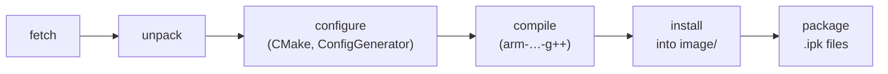

What you should get, as in the verification build:

```text
tmp/work/armv7at2hf-neon-rdkmllib32-linux-gnueabi/lib32-helloworld-plugin/1.0-r0/image/
├── usr/lib/wpeframework/plugins/libWPEFrameworkHelloWorld.so
└── etc/WPEFramework/plugins/HelloWorld.json
```

The generated `HelloWorld.json`:

```json
{
 "locator":"libWPEFrameworkHelloWorld.so",
 "classname":"HelloWorld",
 "precondition":[
  "Platform"
 ],
 "callsign":"HelloWorld",
 "autostart":true,
 "configuration":{
  "greeting":"Hello"
 }
}
```

Notice how the template turned into the file Thunder reads: `locator` and
`classname` were added by the generator, and the `@…@` values were filled in.

The packages are in
`tmp/work/armv7at2hf-neon-rdkmllib32-linux-gnueabi/lib32-helloworld-plugin/1.0-r0/deploy-ipks/armv7at2hf-neon/`.

---

## Stop 12: put it on the TV

You have two options.

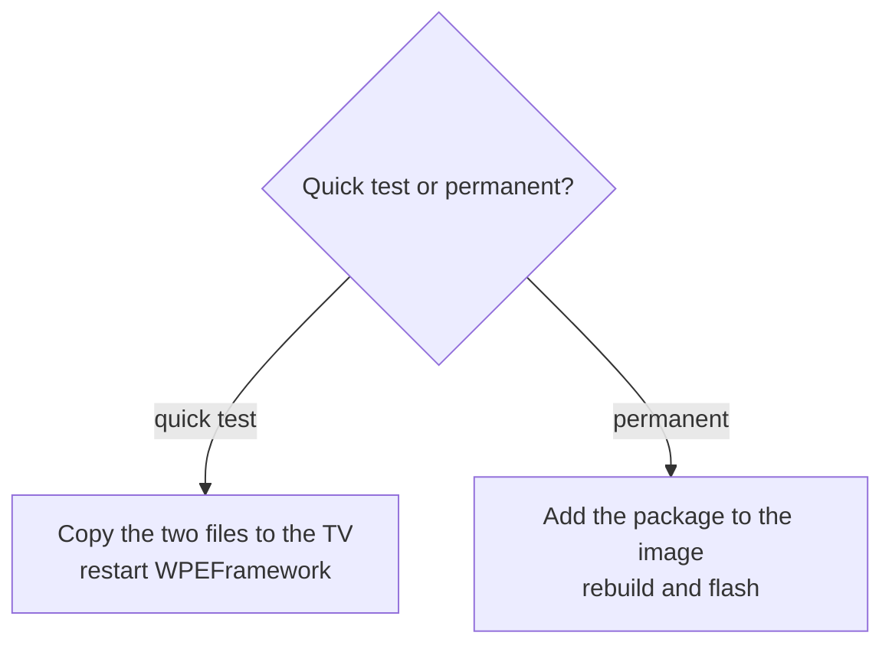

### Option A: copy the files (fast)

1. Copy the two files from the `image/` folder in Stop 11 to the TV, for example
   with a USB stick (mounted under `/tmp/sd*` on the TV) or `scp`.
2. On the TV, put them in place. If `/` is read-only, remount it first:

   ```sh
   mount -o remount,rw /
   cp libWPEFrameworkHelloWorld.so /usr/lib/wpeframework/plugins/
   cp HelloWorld.json /etc/WPEFramework/plugins/
   systemctl restart wpeframework
   ```

`WPEFramework` reads plugin configs only at start, so the restart is needed.

### Option B: add it to the image (permanent)

Add the package to the image, for example in the Elaraby image recipe:

```bitbake
IMAGE_INSTALL_append = " helloworld-plugin"
```

In the `lib32` image this automatically means `lib32-helloworld-plugin`. Then build
and flash the full image as usual.

---

## Stop 13: call it

**1. Is it activated?**

```sh
curl -s -X POST -H 'Content-Type: application/json' \
  -d '{"jsonrpc":"2.0","id":1,"method":"Controller.1.status@HelloWorld"}' \
  http://127.0.0.1:9998/jsonrpc
```

Look for `"state":"activated"`. With `autostart` set to `false`, activate it
yourself:

```sh
curl -s -X POST -H 'Content-Type: application/json' \
  -d '{"jsonrpc":"2.0","id":2,"method":"Controller.1.activate","params":{"callsign":"HelloWorld"}}' \
  http://127.0.0.1:9998/jsonrpc
```

**2. Say hello:**

```sh
curl -s -X POST -H 'Content-Type: application/json' \
  -d '{"jsonrpc":"2.0","id":3,"method":"HelloWorld.1.sayHello","params":{"name":"Mahmoud"}}' \
  http://127.0.0.1:9998/jsonrpc
```

Expected:

```json
{"jsonrpc":"2.0","id":3,"result":{"message":"Hello, Mahmoud!","count":1,"success":true}}
```

**3. Change the greeting, then read it back:**

```sh
curl -s -X POST -H 'Content-Type: application/json' \
  -d '{"jsonrpc":"2.0","id":4,"method":"HelloWorld.1.setGreeting","params":{"greeting":"Ahlan"}}' \
  http://127.0.0.1:9998/jsonrpc

curl -s -X POST -H 'Content-Type: application/json' \
  -d '{"jsonrpc":"2.0","id":5,"method":"HelloWorld.1.getGreeting"}' \
  http://127.0.0.1:9998/jsonrpc
```

Expected: `{"success":true}`, then `{"greeting":"Ahlan","success":true}` inside
`result`. Calling `sayHello` now returns `"Ahlan, Mahmoud!"` and `"count":2`.

**4. Send a bad request on purpose:**

```sh
curl -s -X POST -H 'Content-Type: application/json' \
  -d '{"jsonrpc":"2.0","id":6,"method":"HelloWorld.1.sayHello","params":{}}' \
  http://127.0.0.1:9998/jsonrpc
```

Because `SayHello` returns `Core::ERROR_BAD_REQUEST`, you get an `error` object
instead of `result`. That's how clients know a call failed.

**5. See your log line:**

```sh
journalctl -u wpeframework -b --no-pager | grep HelloWorld
```

You should see `HelloWorld: initialized with greeting 'Hello'`.

---

## Stop 14: listen to events

`curl` sends one request and closes, so it cannot receive events. Events need a
**WebSocket**, which stays open.

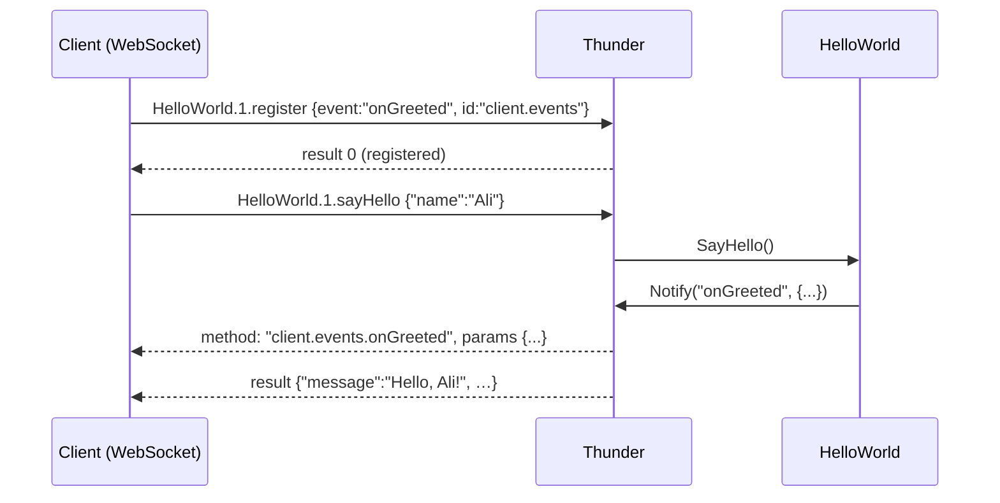

The `id` you register with becomes the prefix of the event name, so one client
can tell its own subscriptions apart.

**Try it from a PC browser.** Open any page, press F12, and paste into the
console (replace the IP address with the TV's):

```javascript
const ws = new WebSocket("ws://192.168.100.153:9998/jsonrpc", "notification");
let id = 1;
const call = (method, params) =>
  ws.send(JSON.stringify({ jsonrpc: "2.0", id: id++, method, params }));

ws.onmessage = (e) => console.log("<<", e.data);
ws.onopen = () => {
  call("HelloWorld.1.register", { event: "onGreeted", id: "client.events" });
  call("HelloWorld.1.sayHello", { name: "Ali" });
};
```

You should see three messages: the `register` result, the `onGreeted` event and
the `sayHello` result.

---

## Stop 15: use it from the UI

The OORO UI calls plugins in exactly this way, over the WebSocket. On the TV the
UI connects to `127.0.0.1:9998`. Here is a small promise-based helper you can
compare with what the UI team uses:

```javascript
class Thunder {
  constructor(host = "127.0.0.1:9998") {
    this.ws = new WebSocket(`ws://${host}/jsonrpc`, "notification");
    this.nextId = 1;
    this.pending = new Map();      // id -> {resolve, reject}
    this.listeners = new Map();    // "client.events.onGreeted" -> callback
    this.ready = new Promise((r) => (this.ws.onopen = r));
    this.ws.onmessage = (e) => this.onMessage(JSON.parse(e.data));
  }

  onMessage(msg) {
    if (msg.id !== undefined && this.pending.has(msg.id)) {
      const { resolve, reject } = this.pending.get(msg.id);
      this.pending.delete(msg.id);
      msg.error ? reject(msg.error) : resolve(msg.result);
    } else if (msg.method && this.listeners.has(msg.method)) {
      this.listeners.get(msg.method)(msg.params);
    }
  }

  async call(method, params) {
    await this.ready;
    const id = this.nextId++;
    this.ws.send(JSON.stringify({ jsonrpc: "2.0", id, method, params }));
    return new Promise((resolve, reject) => this.pending.set(id, { resolve, reject }));
  }

  async on(callsign, event, callback) {
    const id = "client.events";
    this.listeners.set(`${id}.${event}`, callback);
    return this.call(`${callsign}.1.register`, { event, id });
  }
}

// Usage
const thunder = new Thunder();
await thunder.on("HelloWorld", "onGreeted", (p) => console.log("greeted", p));
const result = await thunder.call("HelloWorld.1.sayHello", { name: "OORO" });
console.log(result.message);   // "Hello, OORO!"
```

---

## Stop 16: when things go wrong

```mermaid
flowchart TB
    S{What do you see?}
    S -- "method not found /<br/>unknown callsign" --> A[Is HelloWorld.json in<br/>/etc/WPEFramework/plugins?<br/>Did you restart WPEFramework?]
    S -- "plugin not activated" --> B[Controller.1.status@HelloWorld<br/>Check the journal for the reason]
    S -- "WPEFramework restarts" --> C[A crash in your code<br/>journalctl: ASSERT, Crash, sig=6]
    S -- "build fails" --> D[See the table below]
```

| Symptom | Likely cause | Fix |
|---|---|---|
| CMake: `Could not find … "WPEFrameworkDefinitions"` | `find_package(${NAMESPACE}Definitions)` without `wpeframework-interfaces` | Remove it, or add `wpeframework-interfaces` to `DEPENDS` if you really use those interfaces |
| CMake: `write_config` unknown, or no `.json` produced | Missing `wpeframework-tools-native`, or only a `.config` file | Add the dependency; provide `<Plugin>.conf.in` |
| The plugin package is empty and the `-dev` package has the `.so` | `FILES_SOLIBSDEV` not cleared | Use the `FILES_…` lines from Stop 10 |
| `Controller.1.status@HelloWorld` says `deactivated` | `autostart` is false, or `Initialize` returned an error text | Activate it; check the journal for the reason text |
| The call returns an `error` saying the method or service is unknown | Wrong callsign, version or method name, or the plugin is not activated | Names are case-sensitive: `HelloWorld.1.sayHello` |
| The call returns `error` with `ERROR_BAD_REQUEST` | Your own validation rejected the params | Check the params you send |
| No events arrive | Using `curl`, or the `register` id doesn't match | Use a WebSocket; listen for `<id>.<event>` |
| `WPEFramework` aborts with `sig=6` | An `ASSERT` or exception in your code takes the whole process down (in-process) | Fix the bug; consider out-of-process for risky code |
| Process killed with `SIGSEGV` and an AppArmor `DENIED` line | Your code touches a file the `default` profile does not allow | `dmesg \| grep 'apparmor="DENIED"'`, then extend the profile in `meta-elaraby-aml/recipes-mac/AppArmor/` |

**Useful commands on the TV:**

```sh
journalctl -u wpeframework -b --no-pager | grep -E 'HelloWorld|ASSERT|Crash'
systemctl show wpeframework -p NRestarts
ls -la /usr/lib/wpeframework/plugins/ /etc/WPEFramework/plugins/ | grep -i hello
```

---

## Stop 17: where to go next

You now know the core. Real plugins in this tree add the following, in roughly
this order:

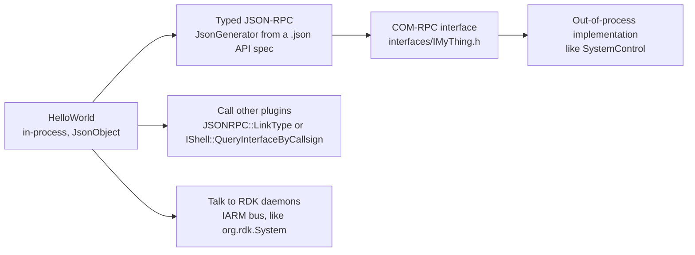

| Next step | What changes | Example in this tree |
|---|---|---|
| Typed API | Describe methods in a JSON spec; JsonGenerator creates typed classes such as `JsonData::SystemControl::…` | `wpeframework-interfaces`, `DTV.json` |
| COM-RPC interface | A C++ interface (`Exchange::ISystemControl`) that other plugins and processes can call directly | `systemcontrol_git.bb` |
| Out-of-process | The plugin class becomes a thin proxy; the work runs in `WPEProcess` (`"mode": "Local"` in the config) | SystemControl (`SystemControl.cpp` + `SystemControlImpl.cpp`) |
| IARM bus | Call `dsMgr`, `pwrMgr` and other daemons | `org.rdk.System`, `org.rdk.DisplaySettings` in `rdkservices` |

A good exercise: change HelloWorld so that `sayHello` also returns the TV's power
state by calling `org.rdk.System.1.getDevicePowerState` from inside the plugin.

---

## Glossary

| Term | Meaning |
|---|---|
| Thunder / WPEFramework | The plugin framework. Thunder is the project name; `WPEFramework` is the process and C++ namespace |
| Plugin | A shared library that Thunder loads, with a config file |
| Callsign | The plugin's public name, used in method names |
| Controller | The built-in plugin that activates, deactivates and reports on all others |
| JSON-RPC | The text protocol clients use, over HTTP or WebSocket on port 9998 |
| COM-RPC | Thunder's binary protocol between plugins and processes |
| `IShell` | Your plugin's handle to Thunder: config, callsign, other plugins |
| Subsystem | A system-wide condition such as `PLATFORM` or `NETWORK`, used for preconditions |
| Event / notification | A message a plugin sends to clients that registered for it |
| ConfigGenerator | The build tool that turns `<Plugin>.conf.in` into `<Plugin>.json` |
