# Your first Thunder plugin: a guided journey

Last updated: 2026-11-17

Welcome to the OORO TV team. This guide takes you from "what is Thunder?" to a
working plugin of your own, running on the TV and answering calls from the UI.
Along the way you'll see how the pieces of the system fit together.

You will build the same small plugin in the two ways Thunder supports:

1. **HelloWorld, in-process** (Stops 5–15). The plugin code runs inside the
   `WPEFramework` process. This is the simplest kind of plugin.
2. **HelloWorldOOP, out-of-process** (Stop 17). The same API, but the work
   runs in a separate `WPEProcess`, connected to `WPEFramework` over COM-RPC.

Both versions:

- answer a method call: `sayHello {"name":"Mahmoud"}` → `"Hello, Mahmoud!"`
- keep state you can read and change: `getGreeting`, `setGreeting`
- send an event to listeners: `onGreeted`
- read their default greeting from their configuration file

> **Status of the code in this guide.**
>
> - **In-process HelloWorld:** built with `bitbake lib32-helloworld-plugin`
>   against Thunder R4.2, with no compiler warnings. On 2026-11-17 it was
>   running on a TV: `Controller.1.status@HelloWorld` reported `activated`,
>   and `sayHello` returned the result shown in Stop 13.
> - **Out-of-process HelloWorldOOP:** built on 2026-11-17 against the same
>   Thunder R4.2, with no compiler warnings. It produces the three libraries
>   and the config file shown in Stop 17. It has not yet been run on a TV, so
>   the results in Stop 17.9 are the expected ones.

> Diagrams use Mermaid. GitHub renders them directly. In VS Code, install the
> *Markdown Preview Mermaid Support* extension to see them in the preview.

---

## The route


**Before you start, you need:**

- A shell on the build machine with the 6.5.0 tree at `/home/rdkuser/OROO-6.5.0`
- A TV running the 6.5.0 debug image, with a serial console or SSH, on the same
  network as your PC
- Basic C++ (classes, virtual functions) and a little JSON

---

## Stop 1: where Thunder lives

Thunder (its process is called `WPEFramework`) is the centre of the TV
software. The UI never talks to drivers or daemons directly: it asks a Thunder
plugin, and the plugin does the work.

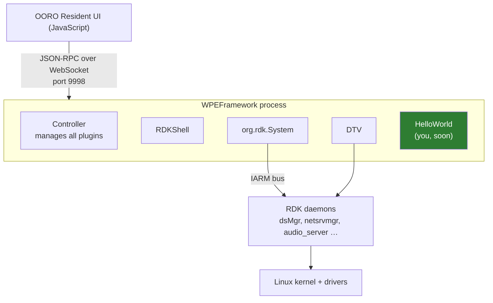

Your HelloWorld plugin sits next to the real ones such as `org.rdk.System` and
`DTV`. It uses the same loading, configuration and call mechanism they do. The
only difference is that it doesn't talk to any hardware.

For the full system picture, see [`RDK-6.5.0-ARCHITECTURE.md`](RDK-6.5.0-ARCHITECTURE.md).

---

## Stop 2: Thunder in five ideas

### Idea 1: a plugin is a shared library

Each plugin is a `.so` file in `/usr/lib/wpeframework/plugins/`, with a
matching config file in `/etc/WPEFramework/plugins/`. When `WPEFramework` starts,
it reads every config file and knows what plugins exist.

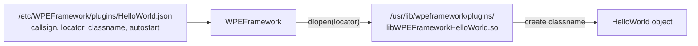

### Idea 2: the callsign is the plugin's name on the bus

The **callsign** is the name clients use, such as `HelloWorld`,
`org.rdk.System` or `DTV`. A method is called as `<callsign>.<version>.<method>`:

```text
HelloWorld.1.sayHello
└──┬─────┘ │ └──┬───┘
callsign   │  method
        API version
```

### Idea 3: every plugin has a lifecycle

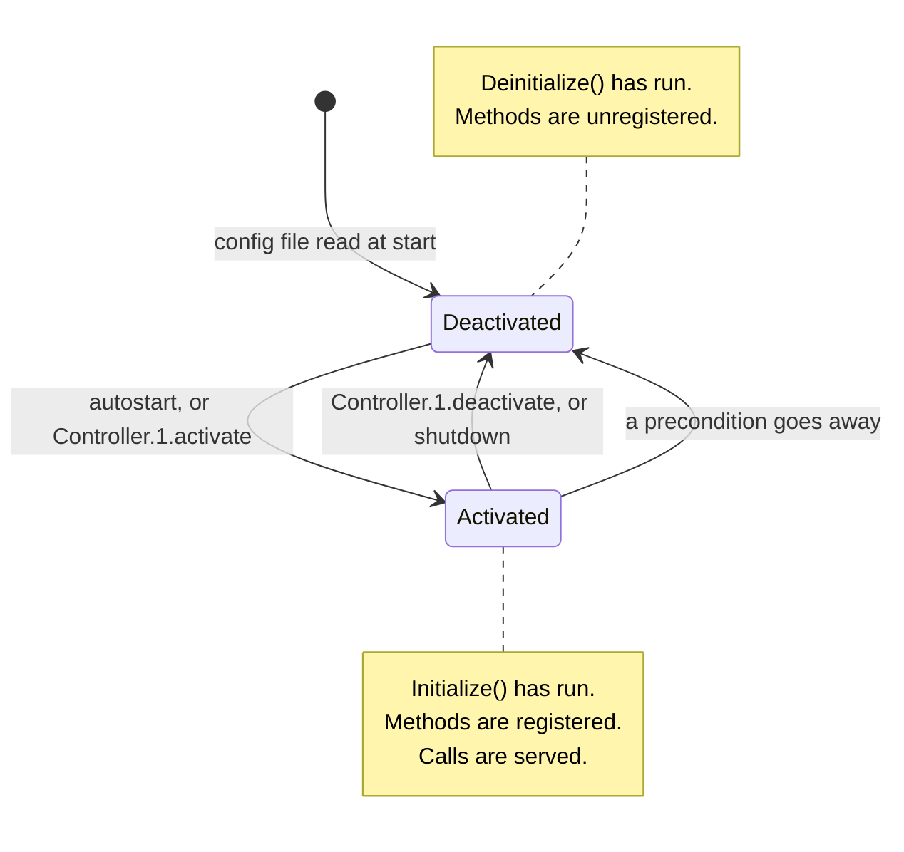

You write two functions for this:

| Function | Called when | You do |
|---|---|---|
| `Initialize(IShell*)` | The plugin is activated | Read config, register methods, start work. Return `""` for success, or an error text |
| `Deinitialize(IShell*)` | The plugin is deactivated | Undo everything `Initialize` did |

### Idea 4: clients talk JSON-RPC 2.0

A call is a small JSON message. The plugin answers with `result` or `error`.

```text
request :  {"jsonrpc":"2.0","id":1,"method":"HelloWorld.1.sayHello","params":{"name":"Mahmoud"}}
response:  {"jsonrpc":"2.0","id":1,"result":{"message":"Hello, Mahmoud!","count":1,"success":true}}
```

### Idea 5: plugins run in-process or out-of-process

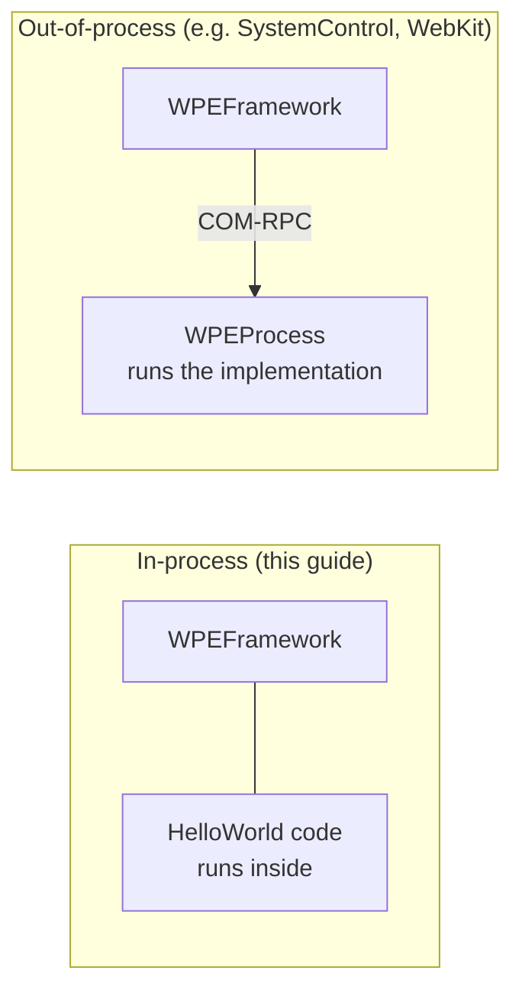

In-process is simplest and fastest, but a crash in your plugin crashes
`WPEFramework` for everyone. That's why big or risky plugins run out-of-process.

| | In-process | Out-of-process |
|---|---|---|
| Where your code runs | Inside `WPEFramework` | In a separate `WPEProcess` started by `WPEFramework` |
| A crash in your code | Takes down `WPEFramework` and every plugin | Kills only your `WPEProcess`; your plugin is deactivated |
| Calls into your code | Direct C++ calls | COM-RPC: binary messages over a local socket |
| Extra pieces you write | None | A C++ interface, an implementation library, a proxy/stub library |
| Examples on the TV | `org.rdk.System`, and DeviceInfo and PersistentStore (split like out-of-process plugins, but configured with `"mode": "Off"`) | SystemControl, DTV, OCDM, ResidentApp, WebKitBrowser (`"mode": "Local"`) |

Start in-process (Stops 5–15).
[Stop 17](#stop-17-the-same-plugin-out-of-process) then builds the
out-of-process version.

---

## Stop 3: anatomy of a call

This is what happens, step by step, when the UI calls your plugin and you send
an event back.

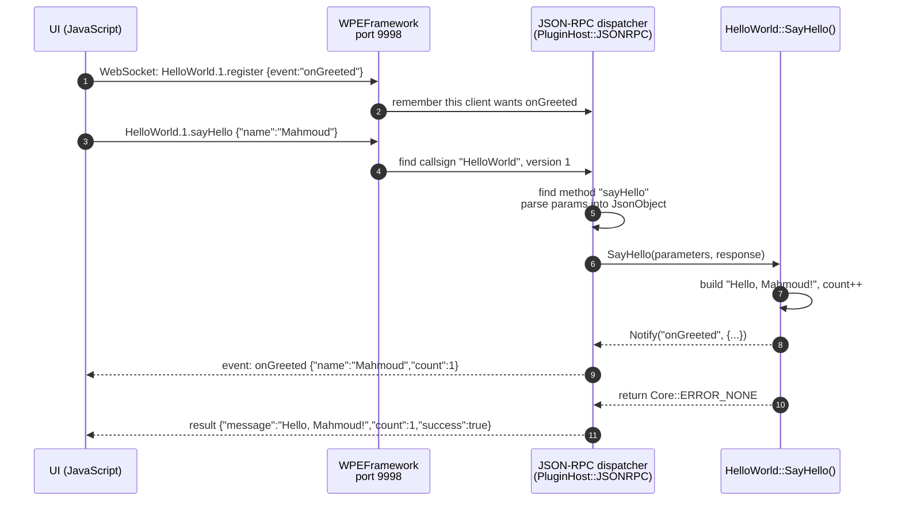

Two important points:

- **You never parse JSON text yourself.** Thunder turns `params` into a
  `JsonObject` for you, and turns your `response` object back into JSON.
- **The return code matters.** `Core::ERROR_NONE` gives the client `result`.
  Any other code, such as `Core::ERROR_BAD_REQUEST`, gives the client an
  `error` object instead.

---

## Stop 4: talk to a real TV first

Before writing code, see Thunder answer on a real TV. Run these on the TV
console. On a PC, replace `127.0.0.1` with the TV's IP address.

> On this debug image, Thunder security is off
> (`ThunderSecurity.Enable = false`), so no token is needed. Production
> images may require a token from the `SecurityAgent` plugin.

**Ask the Controller for one plugin's state:**

```sh
curl -s -X POST -H 'Content-Type: application/json' \
  -d '{"jsonrpc":"2.0","id":1,"method":"Controller.1.status@org.rdk.System"}' \
  http://127.0.0.1:9998/jsonrpc
```

The answer lists the plugin's callsign, its state (`activated`), its config and
more.

**Call a real plugin method:**

```sh
curl -s -X POST -H 'Content-Type: application/json' \
  -d '{"jsonrpc":"2.0","id":2,"method":"org.rdk.System.1.getDevicePowerState"}' \
  http://127.0.0.1:9998/jsonrpc
```

Expected: `{"jsonrpc":"2.0","id":2,"result":{"powerState":"ON","success":true}}`.
That is exactly the shape your plugin will produce.

---

## Stop 5: the project layout

The plugin has two parts: the source code in its own git repository, and one
small recipe in `meta-elaraby-aml` that fetches and builds it.

```text
github.com/Mahmoudaton33/Thunder-Plugin-Implementation   ← the plugin source
├── CMakeLists.txt            ← Stop 9: how CMake builds it
├── HelloWorld.conf.in        ← Stop 8: its config file template
├── Module.h                  ← Stop 6: module boilerplate
├── Module.cpp                ← Stop 6
├── HelloWorld.h              ← Stop 7: the class
└── HelloWorld.cpp            ← Stop 7: the code

meta-elaraby-aml/recipes-extended/helloworld-plugin/
└── helloworld-plugin_1.0.bb  ← Stop 10: how Yocto fetches and builds it
```

> **Starting your own plugin?** While you are still experimenting, you can keep
> the source in the layer instead, under `files/<name>/` next to the recipe, and
> use `SRC_URI = "file://<name>/"`. Move it to its own repository once it works.
> Stop 17 builds the out-of-process version this way.

How the files turn into what runs on the TV:

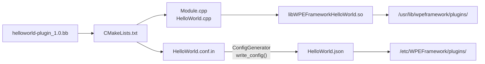

Create the recipe folder:

```sh
cd /home/rdkuser/OROO-6.5.0/meta-elaraby-aml
mkdir -p recipes-extended/helloworld-plugin
```

---

## Stop 6: module boilerplate (`Module.h`, `Module.cpp`)

Every Thunder plugin has these two small files. They give the library a name
and pull in the Thunder plugin API.

**`Module.h`**

```cpp
#pragma once

#ifndef MODULE_NAME
#define MODULE_NAME Plugin_HelloWorld
#endif

#include <plugins/plugins.h>

#undef EXTERNAL
#define EXTERNAL
```

| Line | Why |
|---|---|
| `MODULE_NAME Plugin_HelloWorld` | Names this module in Thunder's logging and tracing |
| `#include <plugins/plugins.h>` | The whole plugin API: `IPlugin`, `IShell`, `JSONRPC`, JSON types, logging |
| `EXTERNAL` redefined empty | Plugins don't export extra symbols, so this macro is not needed here |

**`Module.cpp`**

```cpp
#include "Module.h"

MODULE_NAME_DECLARATION(BUILD_REFERENCE)
```

`MODULE_NAME_DECLARATION` adds the module name and build reference into the
library, so Thunder can identify it at load time. Every plugin has exactly one.

---

## Stop 7: the plugin class (`HelloWorld.h`, `HelloWorld.cpp`)

### 7.1 The shape of the class

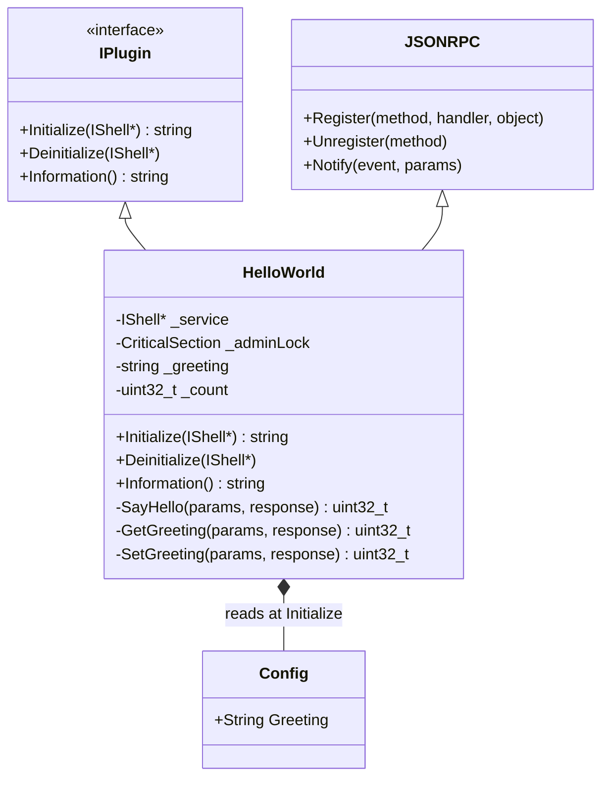

- **`IPlugin`** is the lifecycle contract from Stop 2.
- **`JSONRPC`** gives you method registration and events for free.
- **`Config`** describes the `configuration` part of `HelloWorld.json`.

### 7.2 `HelloWorld.h`

```cpp
#pragma once

#include "Module.h"

namespace WPEFramework {
namespace Plugin {

    class HelloWorld : public PluginHost::IPlugin, public PluginHost::JSONRPC {
    private:
        // Reads the "configuration" object of HelloWorld.json.
        class Config : public Core::JSON::Container {
        public:
            Config(const Config&) = delete;
            Config& operator=(const Config&) = delete;

            Config()
                : Core::JSON::Container()
                , Greeting(_T("Hello"))
            {
                Add(_T("greeting"), &Greeting);
            }
            ~Config() override = default;

        public:
            Core::JSON::String Greeting;
        };

    public:
        HelloWorld(const HelloWorld&) = delete;
        HelloWorld& operator=(const HelloWorld&) = delete;

        HelloWorld();
        ~HelloWorld() override;

        BEGIN_INTERFACE_MAP(HelloWorld)
            INTERFACE_ENTRY(PluginHost::IPlugin)
            INTERFACE_ENTRY(PluginHost::IDispatcher)
        END_INTERFACE_MAP

        // PluginHost::IPlugin
        const string Initialize(PluginHost::IShell* service) override;
        void Deinitialize(PluginHost::IShell* service) override;
        string Information() const override;

    private:
        // JSON-RPC methods
        uint32_t SayHello(const JsonObject& parameters, JsonObject& response);
        uint32_t GetGreeting(const JsonObject& parameters, JsonObject& response);
        uint32_t SetGreeting(const JsonObject& parameters, JsonObject& response);

    private:
        PluginHost::IShell* _service;
        mutable Core::CriticalSection _adminLock;
        string _greeting;
        uint32_t _count;
    };

} // namespace Plugin
} // namespace WPEFramework
```

What each part does:

| Part | Explanation |
|---|---|
| `namespace WPEFramework::Plugin` | All plugins live here, so Thunder types resolve without prefixes |
| `class Config : Core::JSON::Container` | A typed view of JSON. `Add("greeting", &Greeting)` maps the JSON key to a member. `"Hello"` is the default if the key is missing |
| Deleted copy constructor and assignment | Thunder owns the object; copying it would be a bug |
| `BEGIN_INTERFACE_MAP … END_INTERFACE_MAP` | Tells Thunder which interfaces this object offers. `IPlugin` for the lifecycle, `IDispatcher` for JSON-RPC (it comes from `JSONRPC`). Without this map, Thunder cannot find either |
| `uint32_t Method(const JsonObject&, JsonObject&)` | The signature every JSON-RPC method here uses: request params in, response out, error code returned |
| `_service` | The `IShell` handle Thunder gives you: your config, your callsign, and access to other plugins |
| `_adminLock` | Calls can arrive on several Thunder worker threads at once, so shared state needs a lock |

### 7.3 `HelloWorld.cpp`

```cpp
#include "HelloWorld.h"

namespace WPEFramework {

namespace {
    // Tells Thunder the plugin version and which subsystems it needs.
    static Plugin::Metadata<Plugin::HelloWorld> metadata(
        // Version (Major, Minor, Patch)
        1, 0, 0,
        // Preconditions: subsystems that must be up before activation
        {},
        // Terminations: subsystems that deactivate the plugin when they go down
        {},
        // Controls: subsystems this plugin reports as up
        {}
    );
}

namespace Plugin {

    // Makes the class loadable by name ("HelloWorld" in HelloWorld.json).
    SERVICE_REGISTRATION(HelloWorld, 1, 0, 0);

    HelloWorld::HelloWorld()
        : PluginHost::JSONRPC()
        , _service(nullptr)
        , _adminLock()
        , _greeting()
        , _count(0)
    {
    }

    HelloWorld::~HelloWorld() = default;

    const string HelloWorld::Initialize(PluginHost::IShell* service)
    {
        ASSERT(service != nullptr);
        ASSERT(_service == nullptr);

        _service = service;
        _service->AddRef();

        Config config;
        config.FromString(_service->ConfigLine());
        _greeting = config.Greeting.Value();

        Register<JsonObject, JsonObject>(_T("sayHello"), &HelloWorld::SayHello, this);
        Register<JsonObject, JsonObject>(_T("getGreeting"), &HelloWorld::GetGreeting, this);
        Register<JsonObject, JsonObject>(_T("setGreeting"), &HelloWorld::SetGreeting, this);

        SYSLOG(Logging::Startup, (_T("HelloWorld: initialized with greeting '%s'"), _greeting.c_str()));

        // An empty string means success. Any text is an error and Thunder
        // will not activate the plugin.
        return string();
    }

    void HelloWorld::Deinitialize(PluginHost::IShell* service)
    {
        ASSERT(_service == service);

        Unregister(_T("sayHello"));
        Unregister(_T("getGreeting"));
        Unregister(_T("setGreeting"));

        _service->Release();
        _service = nullptr;

        SYSLOG(Logging::Shutdown, (_T("HelloWorld: deinitialized")));
    }

    string HelloWorld::Information() const
    {
        // Not used for JSON-RPC; may return an empty string.
        return string();
    }

    // HelloWorld.1.sayHello {"name":"Mahmoud"}  ->  {"message":"Hello, Mahmoud!","count":1}
    uint32_t HelloWorld::SayHello(const JsonObject& parameters, JsonObject& response)
    {
        if (parameters.HasLabel(_T("name")) == false) {
            response[_T("success")] = false;
            return Core::ERROR_BAD_REQUEST;
        }

        const string name = parameters[_T("name")].String();

        _adminLock.Lock();
        const string message = _greeting + _T(", ") + name + _T("!");
        const uint32_t count = ++_count;
        _adminLock.Unlock();

        response[_T("message")] = message;
        response[_T("count")] = count;
        response[_T("success")] = true;

        // Event to every client that registered for "onGreeted".
        JsonObject event;
        event[_T("name")] = name;
        event[_T("count")] = count;
        Notify(_T("onGreeted"), event);

        return Core::ERROR_NONE;
    }

    // HelloWorld.1.getGreeting  ->  {"greeting":"Hello"}
    uint32_t HelloWorld::GetGreeting(const JsonObject& parameters VARIABLE_IS_NOT_USED, JsonObject& response)
    {
        _adminLock.Lock();
        response[_T("greeting")] = _greeting;
        _adminLock.Unlock();
        response[_T("success")] = true;
        return Core::ERROR_NONE;
    }

    // HelloWorld.1.setGreeting {"greeting":"Ahlan"}  ->  {"success":true}
    uint32_t HelloWorld::SetGreeting(const JsonObject& parameters, JsonObject& response)
    {
        if ((parameters.HasLabel(_T("greeting")) == false) || parameters[_T("greeting")].String().empty()) {
            response[_T("success")] = false;
            return Core::ERROR_BAD_REQUEST;
        }

        _adminLock.Lock();
        _greeting = parameters[_T("greeting")].String();
        _adminLock.Unlock();

        response[_T("success")] = true;
        return Core::ERROR_NONE;
    }

} // namespace Plugin
} // namespace WPEFramework
```

### 7.4 Walking through the code

**Registration: how Thunder finds your class**

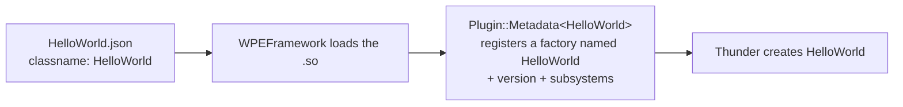

- `Plugin::Metadata<HelloWorld>` is new in Thunder R4. When the library is
  loaded, it registers a factory under the class name, so the `classname` in
  the config file can be turned into an object. It also carries the version
  and three lists of **subsystems** (for example `PLATFORM`, `NETWORK`,
  `GRAPHICS`):
  - *Preconditions*: don't activate until these are up
  - *Terminations*: deactivate if these go down
  - *Controls*: subsystems this plugin itself signals

  HelloWorld needs none, so all three lists are empty. A plugin that needs the
  network would list it under preconditions.
- `SERVICE_REGISTRATION(HelloWorld, 1, 0, 0)` is the older (Thunder R2) way to
  register the same factory. On R4.2 it is redundant for the plugin class,
  because `Plugin::Metadata` already registers it, but it is harmless: Thunder
  uses the first matching entry. You still need `SERVICE_REGISTRATION` for
  classes that are not plugins, such as the out-of-process implementation in
  Stop 17.

**`Initialize`: what happens on activation**

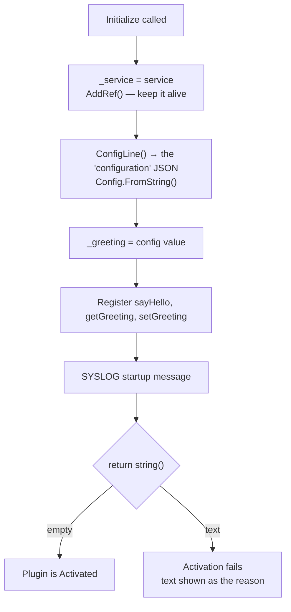

- **`AddRef()` / `Release()`:** Thunder uses reference counting. Keep a reference
  while you hold the pointer, and release it in `Deinitialize`.
- **`ConfigLine()`:** returns the `configuration` object from `HelloWorld.json`
  as text. `Config::FromString()` fills the typed members.
- **`Register<JsonObject, JsonObject>("sayHello", &HelloWorld::SayHello, this)`:**
  binds the JSON-RPC method name to your member function. The two template types
  are the parameter and result types. `JsonObject` accepts any JSON object,
  which keeps a first plugin simple. Larger plugins use generated, typed classes
  instead (see Stop 18).
- **The return value is the success signal.** Return `string()` for success.
  Return a message such as `"Hardware not found"` to refuse activation.

**`SayHello`: one method, start to finish**

| Step | Code | Why |
|---|---|---|
| Check input | `parameters.HasLabel("name")` | Clients can send anything; reject bad input with `ERROR_BAD_REQUEST` |
| Read input | `parameters["name"].String()` | Typed access to a JSON field |
| Update state under the lock | `_adminLock.Lock()` … `Unlock()` | Two clients may call at the same time |
| Fill the response | `response["message"] = …` | Becomes `result` in the reply |
| Send an event | `Notify("onGreeted", event)` | Reaches every client registered for `onGreeted` |
| Return | `Core::ERROR_NONE` | Success; the client receives `result` |

> **Keep the lock short.** Never call `Notify()` or another plugin while holding
> `_adminLock`. That's how deadlocks start. The code copies what it needs, unlocks,
> and only then notifies.

**`Deinitialize`:** the mirror of `Initialize`. Unregister every method, then
release the shell. After this, Thunder may unload your library.

---

## Stop 8: the config template (`HelloWorld.conf.in`)

Thunder R4 builds the plugin's JSON config from a small template. The build
replaces each `@NAME@` with a CMake value.

**`HelloWorld.conf.in`**

```text
precondition = ["Platform"]
callsign = "HelloWorld"
autostart = "@PLUGIN_HELLOWORLD_AUTOSTART@"
startuporder = "@PLUGIN_HELLOWORLD_STARTUPORDER@"

configuration = JSON()
configuration.add("greeting", "@PLUGIN_HELLOWORLD_GREETING@")
```

| Key | Meaning |
|---|---|
| `precondition = ["Platform"]` | Activate only after the platform subsystem is up |
| `callsign` | The name clients use (Stop 2, idea 2) |
| `autostart` | `true`: activate when `WPEFramework` starts. `false`: wait for `Controller.1.activate` |
| `startuporder` | Optional order among autostart plugins. Left empty here, so it is omitted |
| `configuration` | Your own settings. This is the text `ConfigLine()` returns |

> **Why `.conf.in` and not `.config`?** Older plugins ship a `.config` file.
> With CMake 3.20 or newer, Thunder R4's ConfigGenerator only reads `.conf.in`.
> This is why the DTV, SystemControl and FactoryApp recipes needed one added
> during the 6.5.0 port.

---

## Stop 9: the build rules (`CMakeLists.txt`)

**`CMakeLists.txt`**

```cmake
cmake_minimum_required(VERSION 3.3)
project(HelloWorld)

find_package(WPEFramework)

set(PLUGIN_NAME HelloWorld)
set(MODULE_NAME ${NAMESPACE}${PLUGIN_NAME})

set(PLUGIN_HELLOWORLD_AUTOSTART "false" CACHE STRING "Activate the plugin when WPEFramework starts")
set(PLUGIN_HELLOWORLD_STARTUPORDER "" CACHE STRING "Activation order among autostart plugins")
set(PLUGIN_HELLOWORLD_GREETING "Hello" CACHE STRING "Default greeting word")

find_package(${NAMESPACE}Plugins REQUIRED)
find_package(CompileSettingsDebug CONFIG REQUIRED)

add_library(${MODULE_NAME} SHARED
    HelloWorld.cpp
    Module.cpp)

set_target_properties(${MODULE_NAME} PROPERTIES
    CXX_STANDARD 11
    CXX_STANDARD_REQUIRED YES)

target_link_libraries(${MODULE_NAME}
    PRIVATE
        CompileSettingsDebug::CompileSettingsDebug
        ${NAMESPACE}Plugins::${NAMESPACE}Plugins)

string(TOLOWER ${NAMESPACE} STORAGE_DIRECTORY)
install(TARGETS ${MODULE_NAME}
    DESTINATION ${CMAKE_INSTALL_PREFIX}/lib/${STORAGE_DIRECTORY}/plugins)

write_config(${PLUGIN_NAME})
```

| Line | What it does |
|---|---|
| `find_package(WPEFramework)` | Sets `${NAMESPACE}` to `WPEFramework` and loads Thunder's CMake helpers, including `write_config` |
| `MODULE_NAME ${NAMESPACE}${PLUGIN_NAME}` | The library becomes `libWPEFrameworkHelloWorld.so` |
| `set(PLUGIN_HELLOWORLD_… CACHE STRING)` | Defaults for the `@…@` values in `.conf.in`. The recipe can override them with `-D…` |
| `find_package(${NAMESPACE}Plugins)` | The plugin API library and headers |
| `CompileSettingsDebug` | Thunder's standard compiler flags for plugins |
| `install(… lib/wpeframework/plugins)` | Where Thunder looks for plugin libraries |
| `write_config(${PLUGIN_NAME})` | Runs ConfigGenerator on `HelloWorld.conf.in` and installs `HelloWorld.json` to `/etc/WPEFramework/plugins/` |

> **Don't add `find_package(${NAMESPACE}Definitions)` unless you need it.** It
> comes from `wpeframework-interfaces` and is only needed when your plugin uses
> generated interfaces from that package. If you add it without depending on
> `wpeframework-interfaces`, CMake fails with
> `Could not find a package configuration file provided by "WPEFrameworkDefinitions"`.
> That exact error happened while this guide's code was being verified.

---

## Stop 10: the Yocto recipe (`helloworld-plugin_1.0.bb`)

**`recipes-extended/helloworld-plugin/helloworld-plugin_1.0.bb`**

```bitbake
SUMMARY = "Hello World Thunder plugin (training example)"
LICENSE = "CLOSED"

DEPENDS = "wpeframework wpeframework-tools-native"

SRC_URI = "git://github.com/Mahmoudaton33/Thunder-Plugin-Implementation.git;protocol=https;branch=main"
SRCREV = "64914851c32a4b95b60b0496d112723d609e6263"
S = "${WORKDIR}/git"

inherit cmake pkgconfig

EXTRA_OECMAKE += " -DPLUGIN_HELLOWORLD_AUTOSTART=true"
EXTRA_OECMAKE += " -DPLUGIN_HELLOWORLD_GREETING=Hello"

FILES_SOLIBSDEV = ""
FILES_${PN} += "${libdir}/wpeframework/plugins/*.so"
FILES_${PN} += "${sysconfdir}/WPEFramework/plugins/HelloWorld.json"
INSANE_SKIP_${PN} += "dev-so"
```

| Line | Why |
|---|---|
| `DEPENDS = "wpeframework …"` | Thunder headers and libraries for the target |
| `wpeframework-tools-native` | The host-side generators (ConfigGenerator, JsonGenerator) and their CMake modules. Without it, `write_config` is missing |
| `SRC_URI = "git://…;protocol=https;branch=main"` | Fetch the source from the plugin's git repository. `git://` selects bitbake's git fetcher; `protocol=https` makes it download over HTTPS. Kirkstone needs `branch=` (it does not assume `master`) |
| `SRCREV = "6491485…"` | The exact commit to build. Pushing new commits changes nothing until you update this hash, which keeps builds reproducible. Find the latest with `git ls-remote <url> main` |
| `S = "${WORKDIR}/git"` | Where bitbake unpacks a git checkout. The sources are at the root of the repository |
| `inherit cmake pkgconfig` | Build with CMake using the cross toolchain |
| `EXTRA_OECMAKE += -D…` | Overrides the CMake cache defaults, and with them the config file values |
| `FILES_SOLIBSDEV = ""` and `FILES_${PN}` | Plugin `.so` files are runtime files, not development files. Without this, Yocto would put the plugin in the `-dev` package |
| `INSANE_SKIP_${PN} += "dev-so"` | Stops the QA check from complaining about a `.so` in the main package |

> **Old override syntax is correct here.** RDK's kirkstone bitbake still uses
> `FILES_${PN}` and `_append`. Do not convert them to `FILES:${PN}`.

---

## Stop 11: build it

Build just this recipe. This takes a minute or two, not a full image build.

```sh
cd /home/rdkuser/OROO-6.5.0
source openembedded-core/oe-init-build-env build
export MACHINE=mesont5w-5.4-lib32-ea3300-elaraby
bitbake lib32-helloworld-plugin
```

> **Why `lib32-`?** The kernel is 64-bit, but all TV userspace is 32-bit ARM.
> Every userspace recipe is built as its `lib32-` variant.

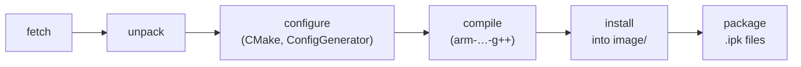

What you should get, as in the verification build:

```text
tmp/work/armv7at2hf-neon-rdkmllib32-linux-gnueabi/lib32-helloworld-plugin/1.0-r0/image/
├── usr/lib/wpeframework/plugins/libWPEFrameworkHelloWorld.so
└── etc/WPEFramework/plugins/HelloWorld.json
```

The generated `HelloWorld.json`:

```json
{
 "locator":"libWPEFrameworkHelloWorld.so",
 "classname":"HelloWorld",
 "precondition":[
  "Platform"
 ],
 "callsign":"HelloWorld",
 "autostart":true,
 "configuration":{
  "greeting":"Hello"
 }
}
```

Notice how the template turned into the file Thunder reads: `locator` and
`classname` were added by the generator, and the `@…@` values were filled in.

The packages are in
`tmp/work/armv7at2hf-neon-rdkmllib32-linux-gnueabi/lib32-helloworld-plugin/1.0-r0/deploy-ipks/armv7at2hf-neon/`.

---

## Stop 12: put it on the TV

You have two options.

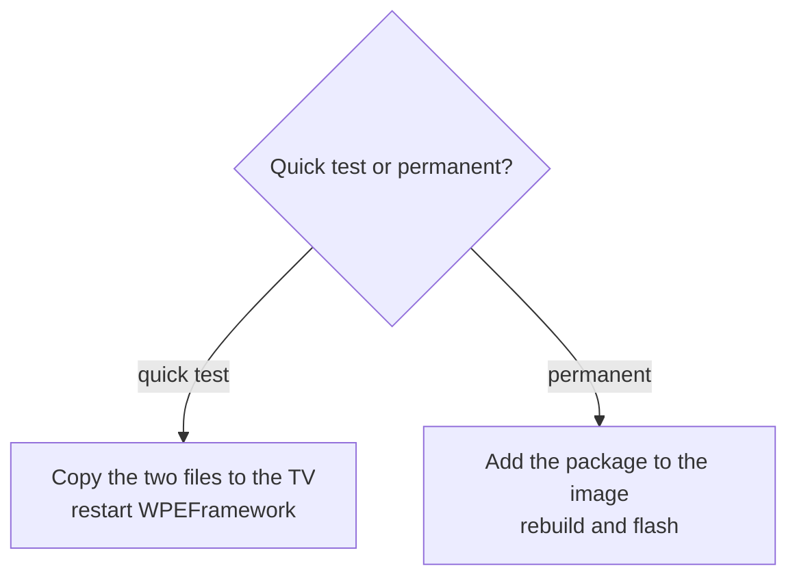

### Option A: copy the files (fast)

1. Copy the two files from the `image/` folder in Stop 11 to the TV, for example
   with a USB stick (mounted under `/tmp/sd*` on the TV) or `scp`.
2. On the TV, put them in place. If `/` is read-only, remount it first:

   ```sh
   mount -o remount,rw /
   cp libWPEFrameworkHelloWorld.so /usr/lib/wpeframework/plugins/
   cp HelloWorld.json /etc/WPEFramework/plugins/
   systemctl restart wpeframework
   ```

`WPEFramework` reads plugin configs only at start, so the restart is needed.

### Option B: add it to the image (permanent)

Add the package to the image, for example in the Elaraby image recipe:

```bitbake
IMAGE_INSTALL_append = " helloworld-plugin"
```

In the `lib32` image this automatically means `lib32-helloworld-plugin`. Then build
and flash the full image as usual.

---

## Stop 13: call it

**1. Is it activated?**

```sh
curl -s -X POST -H 'Content-Type: application/json' \
  -d '{"jsonrpc":"2.0","id":1,"method":"Controller.1.status@HelloWorld"}' \
  http://127.0.0.1:9998/jsonrpc
```

Look for `"state":"activated"`. With `autostart` set to `false`, activate it
yourself:

```sh
curl -s -X POST -H 'Content-Type: application/json' \
  -d '{"jsonrpc":"2.0","id":2,"method":"Controller.1.activate","params":{"callsign":"HelloWorld"}}' \
  http://127.0.0.1:9998/jsonrpc
```

**2. Say hello:**

```sh
curl -s -X POST -H 'Content-Type: application/json' \
  -d '{"jsonrpc":"2.0","id":3,"method":"HelloWorld.1.sayHello","params":{"name":"Mahmoud"}}' \
  http://127.0.0.1:9998/jsonrpc
```

Expected:

```json
{"jsonrpc":"2.0","id":3,"result":{"message":"Hello, Mahmoud!","count":1,"success":true}}
```

**3. Change the greeting, then read it back:**

```sh
curl -s -X POST -H 'Content-Type: application/json' \
  -d '{"jsonrpc":"2.0","id":4,"method":"HelloWorld.1.setGreeting","params":{"greeting":"Ahlan"}}' \
  http://127.0.0.1:9998/jsonrpc

curl -s -X POST -H 'Content-Type: application/json' \
  -d '{"jsonrpc":"2.0","id":5,"method":"HelloWorld.1.getGreeting"}' \
  http://127.0.0.1:9998/jsonrpc
```

Expected: `{"success":true}`, then `{"greeting":"Ahlan","success":true}` inside
`result`. Calling `sayHello` now returns `"Ahlan, Mahmoud!"` and `"count":2`.

**4. Send a bad request on purpose:**

```sh
curl -s -X POST -H 'Content-Type: application/json' \
  -d '{"jsonrpc":"2.0","id":6,"method":"HelloWorld.1.sayHello","params":{}}' \
  http://127.0.0.1:9998/jsonrpc
```

Because `SayHello` returns `Core::ERROR_BAD_REQUEST`, you get an `error` object
instead of `result`. That's how clients know a call failed.

**5. See your log line:**

```sh
journalctl -u wpeframework -b --no-pager | grep HelloWorld
```

You should see `HelloWorld: initialized with greeting 'Hello'`.

---

## Stop 14: listen to events

`curl` sends one request and closes, so it cannot receive events. Events need a
**WebSocket**, which stays open.

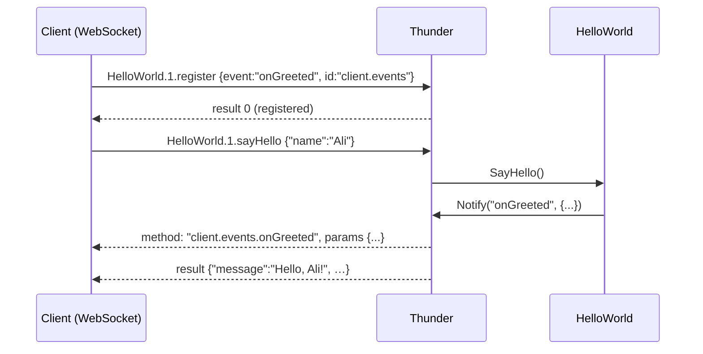

The `id` you register with becomes the prefix of the event name, so one client
can tell its own subscriptions apart.

**Try it from a PC browser.** Open any page, press F12, and paste into the
console (replace the IP address with the TV's):

```javascript
const ws = new WebSocket("ws://192.168.100.153:9998/jsonrpc", "notification");
let id = 1;
const call = (method, params) =>
  ws.send(JSON.stringify({ jsonrpc: "2.0", id: id++, method, params }));

ws.onmessage = (e) => console.log("<<", e.data);
ws.onopen = () => {
  call("HelloWorld.1.register", { event: "onGreeted", id: "client.events" });
  call("HelloWorld.1.sayHello", { name: "Ali" });
};
```

You should see three messages: the `register` result, the `onGreeted` event and
the `sayHello` result.

---

## Stop 15: use it from the UI

The OORO UI calls plugins in exactly this way, over the WebSocket. On the TV the
UI connects to `127.0.0.1:9998`. Here is a small promise-based helper you can
compare with what the UI team uses:

```javascript
class Thunder {
  constructor(host = "127.0.0.1:9998") {
    this.ws = new WebSocket(`ws://${host}/jsonrpc`, "notification");
    this.nextId = 1;
    this.pending = new Map();      // id -> {resolve, reject}
    this.listeners = new Map();    // "client.events.onGreeted" -> callback
    this.ready = new Promise((r) => (this.ws.onopen = r));
    this.ws.onmessage = (e) => this.onMessage(JSON.parse(e.data));
  }

  onMessage(msg) {
    if (msg.id !== undefined && this.pending.has(msg.id)) {
      const { resolve, reject } = this.pending.get(msg.id);
      this.pending.delete(msg.id);
      msg.error ? reject(msg.error) : resolve(msg.result);
    } else if (msg.method && this.listeners.has(msg.method)) {
      this.listeners.get(msg.method)(msg.params);
    }
  }

  async call(method, params) {
    await this.ready;
    const id = this.nextId++;
    this.ws.send(JSON.stringify({ jsonrpc: "2.0", id, method, params }));
    return new Promise((resolve, reject) => this.pending.set(id, { resolve, reject }));
  }

  async on(callsign, event, callback) {
    const id = "client.events";
    this.listeners.set(`${id}.${event}`, callback);
    return this.call(`${callsign}.1.register`, { event, id });
  }
}

// Usage
const thunder = new Thunder();
await thunder.on("HelloWorld", "onGreeted", (p) => console.log("greeted", p));
const result = await thunder.call("HelloWorld.1.sayHello", { name: "OORO" });
console.log(result.message);   // "Hello, OORO!"
```

---

## Stop 16: when things go wrong

```mermaid
flowchart TB
    S{What do you see?}
    S -- "method not found /<br/>unknown callsign" --> A[Is HelloWorld.json in<br/>/etc/WPEFramework/plugins?<br/>Did you restart WPEFramework?]
    S -- "plugin not activated" --> B[Controller.1.status@HelloWorld<br/>Check the journal for the reason]
    S -- "WPEFramework restarts" --> C[A crash in your code<br/>journalctl: ASSERT, Crash, sig=6]
    S -- "build fails" --> D[See the table below]
```

| Symptom | Likely cause | Fix |
|---|---|---|
| CMake: `Could not find … "WPEFrameworkDefinitions"` | `find_package(${NAMESPACE}Definitions)` without `wpeframework-interfaces` | Remove it, or add `wpeframework-interfaces` to `DEPENDS` if you really use those interfaces |
| CMake: `write_config` unknown, or no `.json` produced | Missing `wpeframework-tools-native`, or only a `.config` file | Add the dependency; provide `<Plugin>.conf.in` |
| The plugin package is empty and the `-dev` package has the `.so` | `FILES_SOLIBSDEV` not cleared | Use the `FILES_…` lines from Stop 10 |
| `Controller.1.status@HelloWorld` says `deactivated` | `autostart` is false, or `Initialize` returned an error text | Activate it; check the journal for the reason text |
| The call returns an `error` saying the method or service is unknown | Wrong callsign, version or method name, or the plugin is not activated | Names are case-sensitive: `HelloWorld.1.sayHello` |
| The call returns `error` with `ERROR_BAD_REQUEST` | Your own validation rejected the params | Check the params you send |
| No events arrive | Using `curl`, or the `register` id doesn't match | Use a WebSocket; listen for `<id>.<event>` |
| `WPEFramework` aborts with `sig=6` | An `ASSERT` or exception in your code takes the whole process down (in-process) | Fix the bug; consider out-of-process for risky code |
| Process killed with `SIGSEGV` and an AppArmor `DENIED` line | Your code touches a file the `default` profile does not allow | `dmesg \| grep 'apparmor="DENIED"'`, then extend the profile in `meta-elaraby-aml/recipes-mac/AppArmor/` |
| `curl` from your PC works, but Postman fails | Postman sends the request through a proxy, or through its cloud agent, which cannot reach a `192.168.x.x` address | Postman Settings → Proxy: turn off the system proxy and any custom proxy. Use the desktop app or the Desktop Agent. Send a **POST** with a **raw JSON** body |
| Out-of-process: activation fails with "could not create HelloWorldImplementation" | `Root()` got no object: the implementation `.so` is missing or has another name, the class name is wrong, or `WPEProcess` did not start within the timeout | Check that `root.locator` in the plugin's `.json` names an existing file in `/usr/lib/wpeframework/plugins/`, and that the `SERVICE_REGISTRATION` class name matches the `Root<>()` call. Read the journal |
| Out-of-process: works with `"mode": "Off"` but not with `"Local"` | The proxy/stub library is missing, so the interface cannot cross the process boundary | Check that `libWPEFrameworkHelloWorldOOPProxyStubs.so` is in `/usr/lib/wpeframework/proxystubs/`, then restart `WPEFramework` |
| Out-of-process: the plugin turns `deactivated` on its own | The `WPEProcess` crashed or was killed; `Deactivated()` asked Thunder to deactivate the plugin | Look for the crash in the journal; activate the plugin again to start a new `WPEProcess` |

**Useful commands on the TV:**

```sh
journalctl -u wpeframework -b --no-pager | grep -E 'HelloWorld|ASSERT|Crash'
systemctl show wpeframework -p NRestarts
ls -la /usr/lib/wpeframework/plugins/ /etc/WPEFramework/plugins/ | grep -i hello
```

---

## Stop 17: the same plugin, out-of-process

In-process HelloWorld works, but all of its code runs inside `WPEFramework`. A
bug that crashes it, such as a `nullptr` dereference, takes down every plugin
on the TV and the UI with them. This stop builds **HelloWorldOOP**. It has the
same JSON-RPC API, but its work runs in a separate process.

### 17.1 What changes

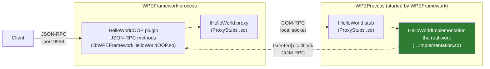

The plugin is split into three libraries:

| Library | Loaded by | Contains |
|---|---|---|
| `libWPEFrameworkHelloWorldOOP.so` | `WPEFramework` | The plugin class: lifecycle, JSON-RPC methods and events. It holds no state of its own |
| `libWPEFrameworkHelloWorldOOPImplementation.so` | `WPEProcess` (or `WPEFramework`, see 17.10) | The implementation class: the greeting, the counter and the logic |
| `libWPEFrameworkHelloWorldOOPProxyStubs.so` | Both processes, at start-up | Generated code that turns `IHelloWorld` calls into COM-RPC messages and back |

The plugin and the implementation talk only through a C++ interface,
`Exchange::IHelloWorld`. That interface is the contract between them.

One call, step by step:

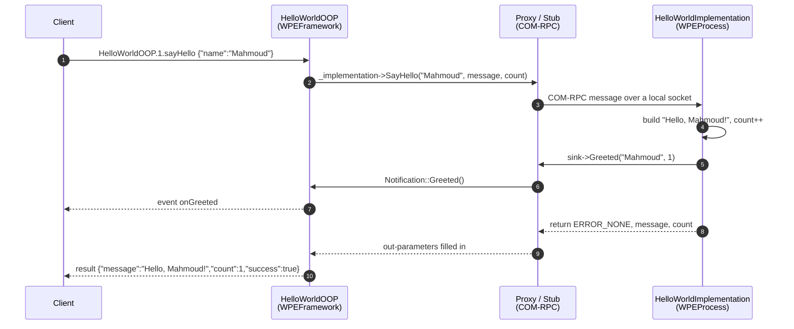

### 17.2 Project layout

The source lives in the layer here, under `files/`. You can move it to its own
git repository later, as HelloWorld did (Stop 10).

```text
meta-elaraby-aml/recipes-extended/helloworldoop-plugin/
├── helloworldoop-plugin_1.0.bb         ← 17.8
└── files/
    └── helloworldoop/
        ├── IHelloWorld.h               ← 17.3 the COM-RPC interface
        ├── HelloWorldImplementation.cpp← 17.4 the work (runs in WPEProcess)
        ├── HelloWorldOOP.h             ← 17.5 the plugin class
        ├── HelloWorldOOP.cpp           ← 17.5
        ├── HelloWorldOOP.conf.in       ← 17.6 config: where to run
        ├── CMakeLists.txt              ← 17.7 builds three libraries
        ├── Module.h                    ← as in Stop 6, with a new name
        └── Module.cpp                  ← as in Stop 6
```

`Module.h` is the one from Stop 6 with `MODULE_NAME` set to
`Plugin_HelloWorldOOP`. `Module.cpp` is identical to Stop 6. All three
libraries compile `Module.cpp`, because every Thunder library needs exactly
one `MODULE_NAME_DECLARATION`.

### 17.3 The interface (`IHelloWorld.h`)

```cpp
#pragma once

#include "Module.h"

namespace WPEFramework {
namespace Exchange {

    // Interface IDs must be unique in the whole system. IDs from
    // ID_OFFSET_CUSTOM (0x80000000) upwards are reserved for private
    // interfaces that are not part of wpeframework-interfaces.
    enum HelloWorldIds : uint32_t {
        ID_HELLOWORLD              = Core::IUnknown::ID_OFFSET_CUSTOM + 0x0100,
        ID_HELLOWORLD_NOTIFICATION = ID_HELLOWORLD + 1
    };

    // The COM-RPC contract between the plugin (inside WPEFramework) and the
    // implementation (inside WPEProcess).
    struct EXTERNAL IHelloWorld : virtual public Core::IUnknown {
        enum { ID = ID_HELLOWORLD };

        // Callback from the implementation back to the plugin.
        struct EXTERNAL INotification : virtual public Core::IUnknown {
            enum { ID = ID_HELLOWORLD_NOTIFICATION };

            ~INotification() override = default;

            virtual void Greeted(const string& name, const uint32_t count) = 0;
        };

        ~IHelloWorld() override = default;

        virtual uint32_t Register(INotification* sink) = 0;
        virtual uint32_t Unregister(INotification* sink) = 0;

        virtual uint32_t Configure(const string& greeting) = 0;
        virtual uint32_t SayHello(const string& name, string& message /* @out */, uint32_t& count /* @out */) = 0;
        virtual uint32_t GetGreeting(string& greeting /* @out */) const = 0;
        virtual uint32_t SetGreeting(const string& greeting) = 0;
        virtual uint32_t ProcessId(uint32_t& pid /* @out */) const = 0;
    };

} // namespace Exchange
} // namespace WPEFramework
```

| Part | Why |
|---|---|
| `struct EXTERNAL IHelloWorld : virtual public Core::IUnknown` | Every COM-RPC interface derives from `Core::IUnknown`, which provides `AddRef`, `Release` and `QueryInterface` |
| `enum { ID = … }` | A number that identifies the interface on the wire. It must be unique on the whole TV. The shared interfaces in `wpeframework-interfaces` take their IDs from `interfaces/Ids.h`. A private interface like this one uses the custom range, which starts at `Core::IUnknown::ID_OFFSET_CUSTOM` (`0x80000000`). No other component on this TV uses that range |
| Only pure virtual methods, returning `uint32_t` | The proxy/stub generator creates code for each method. The `uint32_t` is a Thunder error code, so a call can fail, for example when the other process has died |
| `/* @out */` | Tells the generator that the parameter is filled in by the implementation and must be sent back to the caller |
| Simple types (`string`, integers, `bool`, enums, interface pointers) | These are what COM-RPC copies between processes most easily. For lists, the shared interfaces in this tree use iterator interfaces (for example `ID_DTV_…_ITERATOR` in `Ids.h`) rather than STL containers |
| `INotification` | A second interface, implemented by the plugin, so the implementation can call back. Interface pointers are passed across processes as remote references |

### 17.4 The implementation (`HelloWorldImplementation.cpp`)

This is the code that runs in `WPEProcess`. It knows nothing about JSON-RPC.

```cpp
#include "Module.h"
#include "IHelloWorld.h"

#include <unistd.h>
#include <list>
#include <algorithm>

namespace WPEFramework {
namespace Plugin {

    // The real work. With "mode": "Local" this object lives in a separate
    // WPEProcess; WPEFramework only sees a proxy of it.
    class HelloWorldImplementation : public Exchange::IHelloWorld {
    public:
        HelloWorldImplementation(const HelloWorldImplementation&) = delete;
        HelloWorldImplementation& operator=(const HelloWorldImplementation&) = delete;

        HelloWorldImplementation()
            : _adminLock()
            , _greeting(_T("Hello"))
            , _count(0)
            , _sinks()
        {
        }

        ~HelloWorldImplementation() override
        {
            _adminLock.Lock();
            for (auto sink : _sinks) {
                sink->Release();
            }
            _sinks.clear();
            _adminLock.Unlock();
        }

        BEGIN_INTERFACE_MAP(HelloWorldImplementation)
            INTERFACE_ENTRY(Exchange::IHelloWorld)
        END_INTERFACE_MAP

        uint32_t Register(Exchange::IHelloWorld::INotification* sink) override
        {
            ASSERT(sink != nullptr);

            _adminLock.Lock();
            if (std::find(_sinks.begin(), _sinks.end(), sink) == _sinks.end()) {
                sink->AddRef();
                _sinks.push_back(sink);
            }
            _adminLock.Unlock();

            return Core::ERROR_NONE;
        }

        uint32_t Unregister(Exchange::IHelloWorld::INotification* sink) override
        {
            uint32_t result = Core::ERROR_UNKNOWN_KEY;

            _adminLock.Lock();
            auto index = std::find(_sinks.begin(), _sinks.end(), sink);
            if (index != _sinks.end()) {
                (*index)->Release();
                _sinks.erase(index);
                result = Core::ERROR_NONE;
            }
            _adminLock.Unlock();

            return result;
        }

        uint32_t Configure(const string& greeting) override
        {
            _adminLock.Lock();
            _greeting = greeting;
            _adminLock.Unlock();

            SYSLOG(Logging::Startup, (_T("HelloWorldImplementation: configured in PID %d"), getpid()));
            return Core::ERROR_NONE;
        }

        uint32_t SayHello(const string& name, string& message, uint32_t& count) override
        {
            std::list<Exchange::IHelloWorld::INotification*> sinks;

            _adminLock.Lock();
            message = _greeting + _T(", ") + name + _T("!");
            count = ++_count;
            // Take a reference to every sink, so they can be called without
            // holding the lock.
            for (auto sink : _sinks) {
                sink->AddRef();
                sinks.push_back(sink);
            }
            _adminLock.Unlock();

            for (auto sink : sinks) {
                sink->Greeted(name, count);
                sink->Release();
            }

            return Core::ERROR_NONE;
        }

        uint32_t GetGreeting(string& greeting) const override
        {
            _adminLock.Lock();
            greeting = _greeting;
            _adminLock.Unlock();
            return Core::ERROR_NONE;
        }

        uint32_t SetGreeting(const string& greeting) override
        {
            if (greeting.empty() == true) {
                return Core::ERROR_BAD_REQUEST;
            }

            _adminLock.Lock();
            _greeting = greeting;
            _adminLock.Unlock();
            return Core::ERROR_NONE;
        }

        uint32_t ProcessId(uint32_t& pid) const override
        {
            pid = static_cast<uint32_t>(getpid());
            return Core::ERROR_NONE;
        }

    private:
        mutable Core::CriticalSection _adminLock;
        string _greeting;
        uint32_t _count;
        std::list<Exchange::IHelloWorld::INotification*> _sinks;
    };

    // Lets IShell::Root() create this class by name, in whichever process
    // the "root" configuration selects.
    SERVICE_REGISTRATION(HelloWorldImplementation, 1, 0, 0);

} // namespace Plugin
} // namespace WPEFramework
```

| Part | Why |
|---|---|
| `class HelloWorldImplementation : public Exchange::IHelloWorld` | Implements the interface. There is no `IPlugin` here, so this class has no lifecycle of its own: it lives as long as the plugin holds a reference |
| `INTERFACE_ENTRY(Exchange::IHelloWorld)` | Lets `QueryInterface` (and so COM-RPC) find the interface on this object |
| `SERVICE_REGISTRATION(HelloWorldImplementation, 1, 0, 0)` | Registers a factory under the name `"HelloWorldImplementation"`. That is the name the plugin passes to `Root<>()`. Without it, `Root()` returns `nullptr` |
| `Register` / `Unregister` with `AddRef` / `Release` | The implementation keeps the plugin's notification sink alive while it holds it. Across processes, that pointer is a proxy back into `WPEFramework` |
| In `SayHello`, sinks are copied and called after `Unlock()` | `Greeted()` is a COM-RPC call back into the other process. Calling out while holding `_adminLock` invites deadlocks. This is the same rule as Stop 7 |
| `ProcessId` | Returns `getpid()`. Only used to show which process the code runs in |

### 17.5 The plugin (`HelloWorldOOP.h`, `HelloWorldOOP.cpp`)

The plugin is now a thin layer: it starts the implementation, turns JSON-RPC
calls into `IHelloWorld` calls, and turns `Greeted()` callbacks into
JSON-RPC events.

**`HelloWorldOOP.h`**

```cpp
#pragma once

#include "Module.h"
#include "IHelloWorld.h"

namespace WPEFramework {
namespace Plugin {

    class HelloWorldOOP : public PluginHost::IPlugin, public PluginHost::JSONRPC {
    private:
        // Reads the "configuration" object of HelloWorldOOP.json.
        class Config : public Core::JSON::Container {
        public:
            Config(const Config&) = delete;
            Config& operator=(const Config&) = delete;

            Config()
                : Core::JSON::Container()
                , Greeting(_T("Hello"))
            {
                Add(_T("greeting"), &Greeting);
            }
            ~Config() override = default;

        public:
            Core::JSON::String Greeting;
        };

        // One object, two jobs:
        //  - IRemoteConnection::INotification: tells us when the WPEProcess
        //    that hosts the implementation starts or dies.
        //  - IHelloWorld::INotification: receives Greeted() calls from the
        //    implementation (over COM-RPC when out-of-process).
        class Notification : public RPC::IRemoteConnection::INotification,
                             public Exchange::IHelloWorld::INotification {
        public:
            Notification() = delete;
            Notification(const Notification&) = delete;
            Notification& operator=(const Notification&) = delete;

            explicit Notification(HelloWorldOOP& parent)
                : _parent(parent)
            {
            }
            ~Notification() override = default;

            BEGIN_INTERFACE_MAP(Notification)
                INTERFACE_ENTRY(Exchange::IHelloWorld::INotification)
                INTERFACE_ENTRY(RPC::IRemoteConnection::INotification)
            END_INTERFACE_MAP

            // RPC::IRemoteConnection::INotification
            void Activated(RPC::IRemoteConnection*) override
            {
            }
            void Deactivated(RPC::IRemoteConnection* connection) override
            {
                _parent.Deactivated(connection);
            }

            // Exchange::IHelloWorld::INotification
            void Greeted(const string& name, const uint32_t count) override
            {
                _parent.Greeted(name, count);
            }

        private:
            HelloWorldOOP& _parent;
        };

    public:
        HelloWorldOOP(const HelloWorldOOP&) = delete;
        HelloWorldOOP& operator=(const HelloWorldOOP&) = delete;

        HelloWorldOOP();
        ~HelloWorldOOP() override;

        BEGIN_INTERFACE_MAP(HelloWorldOOP)
            INTERFACE_ENTRY(PluginHost::IPlugin)
            INTERFACE_ENTRY(PluginHost::IDispatcher)
            INTERFACE_AGGREGATE(Exchange::IHelloWorld, _implementation)
        END_INTERFACE_MAP

        // PluginHost::IPlugin
        const string Initialize(PluginHost::IShell* service) override;
        void Deinitialize(PluginHost::IShell* service) override;
        string Information() const override;

    private:
        void Deactivated(RPC::IRemoteConnection* connection);
        void Greeted(const string& name, const uint32_t count);

        // JSON-RPC methods
        uint32_t SayHello(const JsonObject& parameters, JsonObject& response);
        uint32_t GetGreeting(const JsonObject& parameters, JsonObject& response);
        uint32_t SetGreeting(const JsonObject& parameters, JsonObject& response);
        uint32_t GetProcessInfo(const JsonObject& parameters, JsonObject& response);

    private:
        PluginHost::IShell* _service;
        uint32_t _connectionId;
        Exchange::IHelloWorld* _implementation;
        Core::Sink<Notification> _notification;
    };

} // namespace Plugin
} // namespace WPEFramework
```

**`HelloWorldOOP.cpp`**

```cpp
#include "HelloWorldOOP.h"

#include <unistd.h>

namespace WPEFramework {

namespace {
    static Plugin::Metadata<Plugin::HelloWorldOOP> metadata(
        // Version (Major, Minor, Patch)
        1, 0, 0,
        // Preconditions
        {},
        // Terminations
        {},
        // Controls
        {}
    );
}

namespace Plugin {

    // How long Initialize() waits for WPEProcess to start and hand back the
    // implementation.
    static constexpr uint32_t ImplementationTimeout = 2000; // ms

    HelloWorldOOP::HelloWorldOOP()
        : PluginHost::JSONRPC()
        , _service(nullptr)
        , _connectionId(0)
        , _implementation(nullptr)
        , _notification(*this)
    {
    }

    HelloWorldOOP::~HelloWorldOOP() = default;

    const string HelloWorldOOP::Initialize(PluginHost::IShell* service)
    {
        ASSERT(service != nullptr);
        ASSERT(_service == nullptr);
        ASSERT(_implementation == nullptr);
        ASSERT(_connectionId == 0);

        string message;

        _service = service;
        _service->AddRef();

        // Register before Root(), so a crash during start-up is not missed.
        _service->Register(&_notification);

        // Start (or load) the implementation. The "root" object in the config
        // decides where: "Local" = a new WPEProcess, "Off" = inside
        // WPEFramework. _connectionId identifies the WPEProcess.
        _implementation = _service->Root<Exchange::IHelloWorld>(_connectionId, ImplementationTimeout, _T("HelloWorldImplementation"));

        if (_implementation == nullptr) {
            message = _T("HelloWorldOOP: could not create HelloWorldImplementation");
        } else {
            Config config;
            config.FromString(_service->ConfigLine());

            _implementation->Configure(config.Greeting.Value());
            _implementation->Register(&_notification);

            Register<JsonObject, JsonObject>(_T("sayHello"), &HelloWorldOOP::SayHello, this);
            Register<JsonObject, JsonObject>(_T("getGreeting"), &HelloWorldOOP::GetGreeting, this);
            Register<JsonObject, JsonObject>(_T("setGreeting"), &HelloWorldOOP::SetGreeting, this);
            Register<JsonObject, JsonObject>(_T("getProcessInfo"), &HelloWorldOOP::GetProcessInfo, this);

            SYSLOG(Logging::Startup, (_T("HelloWorldOOP: plugin in PID %d, implementation connection %u"), getpid(), _connectionId));
        }

        // With Thunder R4.2's default "legacyinitialize": true, Thunder does
        // NOT call Deinitialize() after a failed Initialize(). Clean up here.
        if (message.empty() == false) {
            Deinitialize(service);
        }

        return message;
    }

    void HelloWorldOOP::Deinitialize(PluginHost::IShell* service)
    {
        ASSERT(_service == service);

        // Stop hearing about the remote process before tearing it down.
        _service->Unregister(&_notification);

        if (_implementation != nullptr) {
            Unregister(_T("sayHello"));
            Unregister(_T("getGreeting"));
            Unregister(_T("setGreeting"));
            Unregister(_T("getProcessInfo"));

            _implementation->Unregister(&_notification);

            // Get the connection before releasing the last reference.
            RPC::IRemoteConnection* connection = _service->RemoteConnection(_connectionId);

            VARIABLE_IS_NOT_USED uint32_t result = _implementation->Release();
            _implementation = nullptr;

            // Ours was the last reference, so the object must be destroyed.
            ASSERT(result == Core::ERROR_DESTRUCTION_SUCCEEDED);

            // Out-of-process only: stop the WPEProcess (it is killed if it
            // does not exit by itself). In-process, connection is nullptr.
            if (connection != nullptr) {
                connection->Terminate();
                connection->Release();
            }
        }

        _connectionId = 0;
        _service->Release();
        _service = nullptr;

        SYSLOG(Logging::Shutdown, (_T("HelloWorldOOP: deinitialized")));
    }

    string HelloWorldOOP::Information() const
    {
        return string();
    }

    // Called by Thunder (on its own thread) when any remote process goes
    // away. If it is ours, the implementation crashed or was killed: ask
    // Thunder to deactivate the plugin cleanly. This must not be done
    // directly here, so it is queued as a job.
    void HelloWorldOOP::Deactivated(RPC::IRemoteConnection* connection)
    {
        if (connection->Id() == _connectionId) {
            ASSERT(_service != nullptr);
            Core::IWorkerPool::Instance().Submit(PluginHost::IShell::Job::Create(_service,
                PluginHost::IShell::DEACTIVATED, PluginHost::IShell::FAILURE));
        }
    }

    // The implementation called IHelloWorld::INotification::Greeted().
    // Turn it into a JSON-RPC event.
    void HelloWorldOOP::Greeted(const string& name, const uint32_t count)
    {
        JsonObject event;
        event[_T("name")] = name;
        event[_T("count")] = count;
        Notify(_T("onGreeted"), event);
    }

    // HelloWorldOOP.1.sayHello {"name":"Mahmoud"}  ->  {"message":"Hello, Mahmoud!","count":1}
    uint32_t HelloWorldOOP::SayHello(const JsonObject& parameters, JsonObject& response)
    {
        if (parameters.HasLabel(_T("name")) == false) {
            return Core::ERROR_BAD_REQUEST;
        }

        string message;
        uint32_t count = 0;

        // A COM-RPC call: runs in the WPEProcess when out-of-process.
        const uint32_t result = _implementation->SayHello(parameters[_T("name")].String(), message, count);

        if (result == Core::ERROR_NONE) {
            response[_T("message")] = message;
            response[_T("count")] = count;
            response[_T("success")] = true;
        }

        return result;
    }

    // HelloWorldOOP.1.getGreeting  ->  {"greeting":"Hello"}
    uint32_t HelloWorldOOP::GetGreeting(const JsonObject& parameters VARIABLE_IS_NOT_USED, JsonObject& response)
    {
        string greeting;
        const uint32_t result = _implementation->GetGreeting(greeting);

        if (result == Core::ERROR_NONE) {
            response[_T("greeting")] = greeting;
            response[_T("success")] = true;
        }

        return result;
    }

    // HelloWorldOOP.1.setGreeting {"greeting":"Ahlan"}  ->  {"success":true}
    uint32_t HelloWorldOOP::SetGreeting(const JsonObject& parameters, JsonObject& response)
    {
        if (parameters.HasLabel(_T("greeting")) == false) {
            return Core::ERROR_BAD_REQUEST;
        }

        const uint32_t result = _implementation->SetGreeting(parameters[_T("greeting")].String());

        if (result == Core::ERROR_NONE) {
            response[_T("success")] = true;
        }

        return result;
    }

    // HelloWorldOOP.1.getProcessInfo  ->  {"pluginPid":1234,"implementationPid":5678,"outOfProcess":true}
    uint32_t HelloWorldOOP::GetProcessInfo(const JsonObject& parameters VARIABLE_IS_NOT_USED, JsonObject& response)
    {
        uint32_t implementationPid = 0;
        const uint32_t result = _implementation->ProcessId(implementationPid);

        if (result == Core::ERROR_NONE) {
            const uint32_t pluginPid = static_cast<uint32_t>(getpid());
            response[_T("pluginPid")] = pluginPid;
            response[_T("implementationPid")] = implementationPid;
            response[_T("outOfProcess")] = (pluginPid != implementationPid);
            response[_T("success")] = true;
        }

        return result;
    }

} // namespace Plugin
} // namespace WPEFramework
```

What is new compared with in-process HelloWorld:

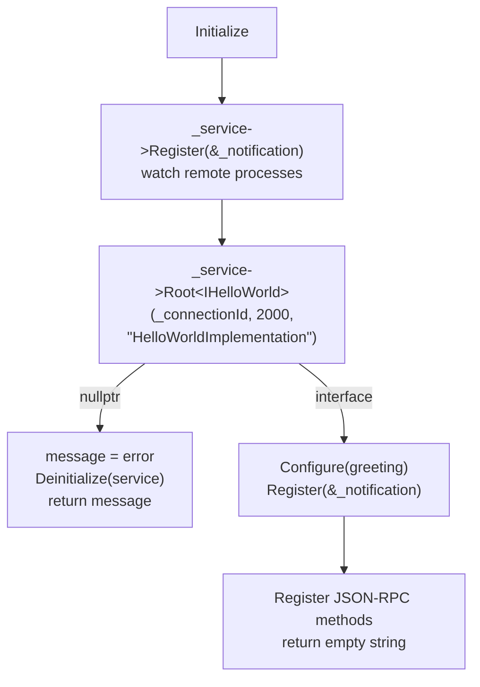

| Part | Why |
|---|---|
| `_service->Root<Exchange::IHelloWorld>(_connectionId, 2000, "HelloWorldImplementation")` | The key call. Thunder reads the `root` object from the plugin's config. With `"mode": "Local"` it starts a `WPEProcess`, which loads the implementation library and creates `HelloWorldImplementation`. You get back a proxy, plus `_connectionId` to identify that process. Thunder waits up to 2000 ms |
| `class Notification` | One object that implements two callback interfaces. `RPC::IRemoteConnection::INotification` tells you when a `WPEProcess` starts or stops. `IHelloWorld::INotification` receives `Greeted()` |
| `Core::Sink<Notification>` | Wraps the object with a reference count that never deletes it, so it can be a member variable but still be handed out as a COM interface |
| `_service->Register(&_notification)` before `Root()` | So a crash during start-up is reported too |
| `Deactivated(connection)` | Called when any remote process goes away. If it is ours, the implementation has crashed. The plugin cannot deactivate itself from inside this callback, so it queues `IShell::Job::Create(…, DEACTIVATED, FAILURE)` on Thunder's worker pool |
| `Deinitialize(service)` called from `Initialize()` on failure | In this Thunder R4.2 build, `legacyinitialize` defaults to `true`, and with that Thunder does **not** call `Deinitialize()` after a failed `Initialize()`. The plugin must clean up itself |
| `RemoteConnection(_connectionId)` before `Release()` | Gets the process handle while it still exists. After releasing the last reference, `connection->Terminate()` asks the `WPEProcess` to exit and kills it if it doesn't |
| `ASSERT(result == Core::ERROR_DESTRUCTION_SUCCEEDED)` | The plugin should hold the last reference. If not, something leaked |
| `INTERFACE_AGGREGATE(Exchange::IHelloWorld, _implementation)` | Lets other plugins (and other processes) get `IHelloWorld` directly with `QueryInterfaceByCallsign<Exchange::IHelloWorld>("HelloWorldOOP")`, without going through JSON-RPC |
| No lock in the plugin | The plugin holds no state. All state, and its lock, are in the implementation |
| `getProcessInfo` | A new method that returns both PIDs, so you can see the split |

### 17.6 The config template (`HelloWorldOOP.conf.in`)

```text
precondition = ["Platform"]
callsign = "HelloWorldOOP"
autostart = "@PLUGIN_HELLOWORLDOOP_AUTOSTART@"
startuporder = "@PLUGIN_HELLOWORLDOOP_STARTUPORDER@"

process = JSON()
process.add("mode", "@PLUGIN_HELLOWORLDOOP_MODE@")
process.add("locator", "lib@PLUGIN_IMPLEMENTATION@.so")

configuration = JSON()
configuration.add("root", process)
configuration.add("greeting", "@PLUGIN_HELLOWORLDOOP_GREETING@")
```

The new part is the `root` object inside `configuration`:

| Key | Meaning |
|---|---|
| `root.mode` | `"Local"`: run the implementation in a new `WPEProcess` on the same TV. `"Off"`: load it inside `WPEFramework` (in-process). (`"Container"` and `"Distributed"` exist but are not used on this TV) |
| `root.locator` | The implementation library. Thunder looks for it in the same folder as the plugin library |

The generated `HelloWorldOOP.json`, from the verification build:

```json
{
 "locator":"libWPEFrameworkHelloWorldOOP.so",
 "classname":"HelloWorldOOP",
 "precondition":[
  "Platform"
 ],
 "callsign":"HelloWorldOOP",
 "autostart":true,
 "configuration":{
  "root":{
   "mode":"Local",
   "locator":"libWPEFrameworkHelloWorldOOPImplementation.so"
  },
  "greeting":"Hello"
 }
}
```

### 17.7 The build rules (`CMakeLists.txt`)

```cmake
cmake_minimum_required(VERSION 3.3)
project(HelloWorldOOP)

find_package(WPEFramework)

set(PLUGIN_NAME HelloWorldOOP)
set(MODULE_NAME ${NAMESPACE}${PLUGIN_NAME})
set(PLUGIN_IMPLEMENTATION ${MODULE_NAME}Implementation)
set(PLUGIN_PROXYSTUBS ${MODULE_NAME}ProxyStubs)

set(PLUGIN_HELLOWORLDOOP_AUTOSTART "false" CACHE STRING "Activate the plugin when WPEFramework starts")
set(PLUGIN_HELLOWORLDOOP_STARTUPORDER "" CACHE STRING "Activation order among autostart plugins")
set(PLUGIN_HELLOWORLDOOP_MODE "Local" CACHE STRING "Where the implementation runs: Off (in-process) or Local (WPEProcess)")
set(PLUGIN_HELLOWORLDOOP_GREETING "Hello" CACHE STRING "Default greeting word")

find_package(${NAMESPACE}Plugins REQUIRED)
find_package(CompileSettingsDebug CONFIG REQUIRED)
find_package(ProxyStubGenerator REQUIRED)

string(TOLOWER ${NAMESPACE} STORAGE_DIRECTORY)

# 1. The plugin: loaded by WPEFramework, owns the JSON-RPC API.
add_library(${MODULE_NAME} SHARED
    HelloWorldOOP.cpp
    Module.cpp)

# 2. The implementation: loaded by WPEProcess ("Local") or by
#    WPEFramework ("Off").
add_library(${PLUGIN_IMPLEMENTATION} SHARED
    HelloWorldImplementation.cpp
    Module.cpp)

# 3. The proxy/stub library: lets IHelloWorld cross the process boundary.
#    Generated from IHelloWorld.h at configure time.
ProxyStubGenerator(
    INPUT "${CMAKE_CURRENT_SOURCE_DIR}/IHelloWorld.h"
    OUTDIR "${CMAKE_CURRENT_BINARY_DIR}/generated"
    INCLUDE_PATH "${CMAKE_SYSROOT}${CMAKE_INSTALL_PREFIX}/include/${NAMESPACE}")

add_library(${PLUGIN_PROXYSTUBS} SHARED
    "${CMAKE_CURRENT_BINARY_DIR}/generated/ProxyStubs_HelloWorld.cpp"
    Module.cpp)

target_include_directories(${PLUGIN_PROXYSTUBS} PRIVATE "${CMAKE_CURRENT_SOURCE_DIR}")

foreach(target ${MODULE_NAME} ${PLUGIN_IMPLEMENTATION} ${PLUGIN_PROXYSTUBS})
    set_target_properties(${target} PROPERTIES
        CXX_STANDARD 11
        CXX_STANDARD_REQUIRED YES)

    target_link_libraries(${target}
        PRIVATE
            CompileSettingsDebug::CompileSettingsDebug
            ${NAMESPACE}Plugins::${NAMESPACE}Plugins)
endforeach()

install(TARGETS ${MODULE_NAME} ${PLUGIN_IMPLEMENTATION}
    DESTINATION ${CMAKE_INSTALL_PREFIX}/lib/${STORAGE_DIRECTORY}/plugins)

install(TARGETS ${PLUGIN_PROXYSTUBS}
    DESTINATION ${CMAKE_INSTALL_PREFIX}/lib/${STORAGE_DIRECTORY}/proxystubs)

write_config(${PLUGIN_NAME})
```

| Part | Why |
|---|---|
| Three `add_library(… SHARED …)` | Plugin, implementation and proxy/stubs are separate libraries, because they are loaded by different processes |
| `find_package(ProxyStubGenerator REQUIRED)` | Comes with `wpeframework-tools-native`, which the recipe already depends on |
| `ProxyStubGenerator(INPUT … OUTDIR …)` | Runs at configure time and writes `generated/ProxyStubs_HelloWorld.cpp` from `IHelloWorld.h`. The file name is `ProxyStubs_` plus the header name without the leading `I` |
| `INCLUDE_PATH …/include/WPEFramework` | Lets the generator find Thunder's own headers in the target sysroot |
| Install into `…/proxystubs` | Both `WPEFramework` and `WPEProcess` load every library in `/usr/lib/wpeframework/proxystubs` (`"proxystubpath"` in `/etc/WPEFramework/config.json`) |
| `@PLUGIN_IMPLEMENTATION@` | The `.conf.in` uses this CMake variable for `root.locator`, so the config always names the library that was built |

### 17.8 The recipe (`helloworldoop-plugin_1.0.bb`)

```bitbake
SUMMARY = "Hello World out-of-process Thunder plugin (training example)"
LICENSE = "CLOSED"

DEPENDS = "wpeframework wpeframework-tools-native"

SRC_URI = "file://helloworldoop/"
S = "${WORKDIR}/helloworldoop"

inherit cmake pkgconfig

EXTRA_OECMAKE += " -DPLUGIN_HELLOWORLDOOP_AUTOSTART=true"
EXTRA_OECMAKE += " -DPLUGIN_HELLOWORLDOOP_MODE=Local"
EXTRA_OECMAKE += " -DPLUGIN_HELLOWORLDOOP_GREETING=Hello"

FILES_SOLIBSDEV = ""
FILES_${PN} += "${libdir}/wpeframework/plugins/*.so"
FILES_${PN} += "${libdir}/wpeframework/proxystubs/*.so"
FILES_${PN} += "${sysconfdir}/WPEFramework/plugins/HelloWorldOOP.json"
INSANE_SKIP_${PN} += "dev-so"
```

Compared with Stop 10, it sets `PLUGIN_HELLOWORLDOOP_MODE`, and it packages the
proxy/stub library from `${libdir}/wpeframework/proxystubs`.

Build it:

```sh
cd /home/rdkuser/OROO-6.5.0
source openembedded-core/oe-init-build-env build
export MACHINE=mesont5w-5.4-lib32-ea3300-elaraby
bitbake lib32-helloworldoop-plugin
```

The verification build produced these files in
`tmp/work/armv7at2hf-neon-rdkmllib32-linux-gnueabi/lib32-helloworldoop-plugin/1.0-r0/image/`:

```text
usr/lib/wpeframework/plugins/libWPEFrameworkHelloWorldOOP.so
usr/lib/wpeframework/plugins/libWPEFrameworkHelloWorldOOPImplementation.so
usr/lib/wpeframework/proxystubs/libWPEFrameworkHelloWorldOOPProxyStubs.so
etc/WPEFramework/plugins/HelloWorldOOP.json
```

### 17.9 Put it on the TV and try it

Copy the four files as in Stop 12, Option A, with one more destination:

```sh
# on the build machine, from the image/ folder above
scp usr/lib/wpeframework/plugins/libWPEFrameworkHelloWorldOOP*.so          root@<tv-ip>:/usr/lib/wpeframework/plugins/
scp usr/lib/wpeframework/proxystubs/libWPEFrameworkHelloWorldOOPProxyStubs.so root@<tv-ip>:/usr/lib/wpeframework/proxystubs/
scp etc/WPEFramework/plugins/HelloWorldOOP.json                             root@<tv-ip>:/etc/WPEFramework/plugins/

# on the TV
systemctl restart wpeframework
```

If `/` is read-only, run `mount -o remount,rw /` on the TV first. The restart
is required: the proxy/stub libraries are loaded only when `WPEFramework`
starts.

**1. Is it activated, and is there a `WPEProcess`?**

```sh
curl -s -X POST -H 'Content-Type: application/json' \
  -d '{"jsonrpc":"2.0","id":1,"method":"Controller.1.status@HelloWorldOOP"}' \
  http://127.0.0.1:9998/jsonrpc

ps -ef | grep '[W]PEProcess.*-C HelloWorldOOP'
```

Expected: `"state":"activated"`, and one `WPEProcess` line. Its command line
shows exactly what the config asked for, for example:

```text
root  4501  3368 … WPEProcess -l libWPEFrameworkHelloWorldOOPImplementation.so -c HelloWorldImplementation -C HelloWorldOOP -r /tmp/communicator …
```

`-l` is `root.locator`, `-c` is the class name passed to `Root<>()`, `-C` is
the callsign, and `-r` is the socket the COM-RPC messages travel over. The
other out-of-process plugins on the TV look the same; try
`ps -ef | grep '[W]PEProcess'`.

**2. Call it.** The API is the same as HelloWorld's; only the callsign changes:

```sh
curl -s -X POST -H 'Content-Type: application/json' \
  -d '{"jsonrpc":"2.0","id":2,"method":"HelloWorldOOP.1.sayHello","params":{"name":"Mahmoud"}}' \
  http://127.0.0.1:9998/jsonrpc
```

Expected: `{"jsonrpc":"2.0","id":2,"result":{"message":"Hello, Mahmoud!","count":1,"success":true}}`.
`getGreeting`, `setGreeting` and the `onGreeted` event (Stop 14) work the same
way.

**3. See the two processes:**

```sh
curl -s -X POST -H 'Content-Type: application/json' \
  -d '{"jsonrpc":"2.0","id":3,"method":"HelloWorldOOP.1.getProcessInfo"}' \
  http://127.0.0.1:9998/jsonrpc
```

Expected: two different PIDs and `"outOfProcess":true`. `pluginPid` is the PID
of `WPEFramework` (`pidof WPEFramework`), and `implementationPid` is the
`WPEProcess`.

**4. Crash it on purpose.** This is the point of out-of-process:

```sh
kill -9 <implementationPid>
```

`WPEFramework` keeps running and every other plugin keeps working.
`Deactivated()` sees that its process is gone and deactivates the plugin, so
`Controller.1.status@HelloWorldOOP` now shows `deactivated`. Bring it back
with:

```sh
curl -s -X POST -H 'Content-Type: application/json' \
  -d '{"jsonrpc":"2.0","id":4,"method":"Controller.1.activate","params":{"callsign":"HelloWorldOOP"}}' \
  http://127.0.0.1:9998/jsonrpc
```

A new `WPEProcess` starts, with a new PID. The counter starts again from 0,
because the state lived in the process that was killed. Try the
same `kill -9` on `WPEFramework` with in-process HelloWorld, and the whole
TV software stack restarts.

### 17.10 One code base, either mode

The plugin code never says where the implementation runs. `Root<>()` decides
from the config. Change `"mode"` in `/etc/WPEFramework/plugins/HelloWorldOOP.json`
on the TV from `"Local"` to `"Off"` and restart `WPEFramework`:

- `HelloWorldImplementation` is now loaded inside `WPEFramework`.
- `getProcessInfo` returns the same PID twice and `"outOfProcess":false`.
- Calls are direct C++ calls again: no proxy/stub, no socket.

This is why DeviceInfo and PersistentStore on this TV have a split
implementation but run with `"mode": "Off"`. To make the choice at build time
instead, set `-DPLUGIN_HELLOWORLDOOP_MODE=Off` in the recipe.

### 17.11 In-process or out-of-process?

| Choose | When |
|---|---|
| In-process (Stops 5–15) | Small, well-tested code; you need the lowest latency; the plugin mostly forwards to a daemon (most `org.rdk.*` services) |
| Out-of-process | The code is large, uses third-party libraries, or can crash or hang (browsers, players, DTV); you want to limit its memory or restart it on its own |
| Split, but `"mode": "Off"` | You are not sure yet. Write it out-of-process-ready and decide in the config |

Rules that apply to every out-of-process plugin:

- **Every call can fail.** If the `WPEProcess` dies, calls on the proxy return
  an error instead of crashing. Check the return codes.
- **Calls cost more.** Each call is a message across a socket. Prefer one call
  that does a lot over many small ones.
- **Never call out while holding a lock.** A callback can arrive on another
  thread while you wait.
- **Plan for the process to die.** Handle `Deactivated()` as in 17.5.

---

## Stop 18: where to go next

You now know both kinds of plugin. Real plugins in this tree add the following:

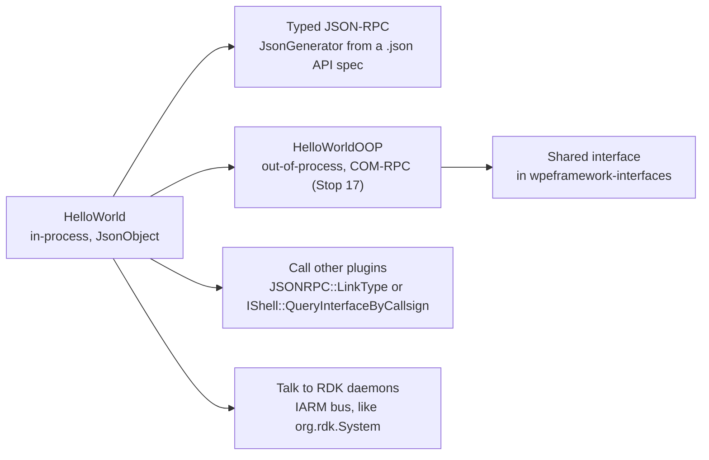

| Next step | What changes | Example in this tree |
|---|---|---|
| Typed API | Describe methods in a JSON spec; JsonGenerator creates typed classes such as `JsonData::SystemControl::…` | `wpeframework-interfaces`, `DTV.json` |
| Shared interface | Move `IHelloWorld.h` into `wpeframework-interfaces` with an ID from `Ids.h`, so other components can use it and its proxy/stubs ship with the rest | `Exchange::ISystemControl`, `Exchange::IDTV` |
| IARM bus | Call `dsMgr`, `pwrMgr` and other daemons | `org.rdk.System`, `org.rdk.DisplaySettings` in `rdkservices` |

A good exercise: change HelloWorld so that `sayHello` also returns the TV's power
state by calling `org.rdk.System.1.getDevicePowerState` from inside the plugin.

---

## Glossary

| Term | Meaning |
|---|---|
| Thunder / WPEFramework | The plugin framework. Thunder is the project name; `WPEFramework` is the process and C++ namespace |
| Plugin | A shared library that Thunder loads, with a config file |
| Callsign | The plugin's public name, used in method names |
| Controller | The built-in plugin that activates, deactivates and reports on all others |
| JSON-RPC | The text protocol clients use, over HTTP or WebSocket on port 9998 |
| COM-RPC | Thunder's binary protocol between plugins and processes |
| `IShell` | Your plugin's handle to Thunder: config, callsign, other plugins |
| Subsystem | A system-wide condition such as `PLATFORM` or `NETWORK`, used for preconditions |
| Event / notification | A message a plugin sends to clients that registered for it |
| ConfigGenerator | The build tool that turns `<Plugin>.conf.in` into `<Plugin>.json` |
| In-process | The plugin's code runs inside the `WPEFramework` process |
| Out-of-process | The plugin's implementation runs in a separate `WPEProcess`, and the plugin reaches it over COM-RPC |
| `WPEProcess` | The host process `WPEFramework` starts for an out-of-process implementation (`"mode": "Local"`) |
| `root` (config) | The part of a plugin's `configuration` that says where `IShell::Root<>()` creates the implementation: `mode` and `locator` |
| `IShell::Root<>()` | Creates the implementation object, in-process or in a `WPEProcess` depending on `root.mode`, and returns an interface to it |
| Interface ID | The unique number (`enum { ID = … }`) that identifies a COM-RPC interface on the wire |
| Proxy / stub | Generated code. The proxy turns interface calls into COM-RPC messages; the stub, in the other process, turns them back into calls |
| ProxyStubGenerator | The build tool that generates the proxy/stub code from an interface header |